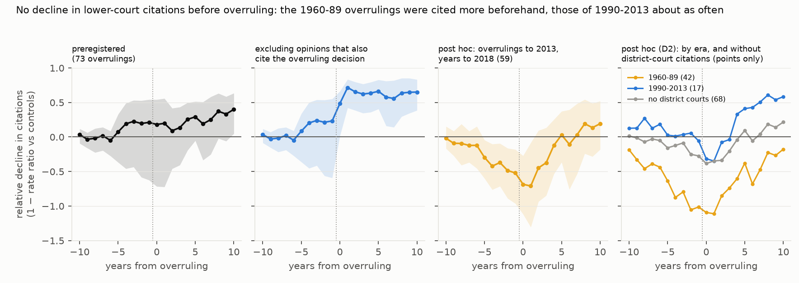
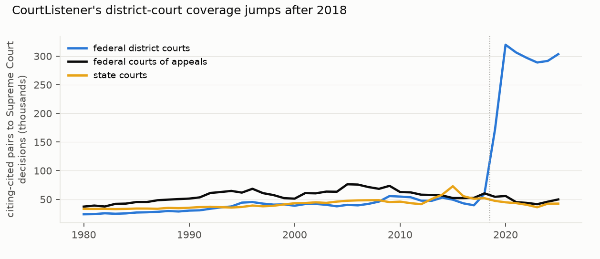

# Do Supreme Court precedents die before they are overruled? Lower-court citation counts show no decline beforehand: the preregistered test could not reach a verdict, and post hoc, overrulings of 1960–89 were cited more in the run-up and those of 1990–2013 about as often

*73 explicitly overruled US Supreme Court decisions (overruled 1960–2024), each against 10 matched never-overruled
Supreme Court decisions. The data are lower-court citations from CourtListener's citation map (2026-09-30 snapshot;
10.6 million lower-court citing–cited pairs to Supreme Court decisions), in a stacked PPML event study. The plan was
committed before any citation was counted. This version includes fixes made after independent review (D2): controls
restricted to SCDB-identified decisions as planned, a citation-parsing fix, and post hoc analyses by era and without
district-court citations.*

**Verdict: H1 not testable** (the preregistered post-overruling decline is not detectable). Post hoc analyses find no
clear decline in citation counts before overruling in any era.

- **H1 (at least a third of the five-year post-overruling decline has happened by the year before overruling): not
  testable by the preregistered rule.**
  - Five years after overruling, the overruled precedents' lower-court citations are 29% below their matched
    controls', but the interval includes zero (−5% to +51%). The pre-share (0.73) is therefore undefined.
  - The year before overruling the gap is 21% (−62% to +54%).
- **Without opinions that also cite the overruling decision,** the five-year decline is clear: 66% (41% to 83%).
  - Part of that decline is mechanical, because later discussion of a precedent tends to cite its overruling
    decision, so 66% is an upper bound.
  - The pre-share is 0.35 (−1.22 to 0.81), Inconclusive by H1's rule.
- **A coverage break distorts recent windows (D1, D2; found after the primary result).**
  - CourtListener's district-court citations to the Supreme Court jump from 59,504 pairs in 2018 to 319,779 in 2020.
    Courts of appeals and state courts stay flat.
  - Stacks whose windows cross 2019 mix that change into the treated–control contrast.
- **Post hoc: the break removed at its source.** Keeping all overrulings and dropping district-court citations
  (68 stacks): D(−1) −0.27 (−0.74 to −0.01), D(+5) +0.09 (−0.26 to +0.37). Citations were, if anything, slightly
  higher than controls before overruling.
- **Post hoc: the pattern depends on era.**
  - **Overrulings of 1960–89 (42 stacks, citations to 2018):** cited about twice as often as controls the year before
    overruling. D(−1) is −1.01 (−1.57 to −0.47).
  - **Overrulings of 1990–2013 (17 stacks):** cited about as often as controls until overruling, D(−1) −0.05 (−0.32
    to +0.14), and clearly less five years after, D(+5) +0.41 (+0.21 to +0.65). H1's precondition holds in this
    group, and its pre-share of −0.13 (−1.22 to +0.31) would read **Refuted** by H1's rule.
  - **Overrulings of 2014–2024, without district-court citations (13 stacks):** D(−1) +0.10 (−0.72 to +0.29), D(+5)
    +0.51 (+0.11 to +0.68).
- **Post hoc: windows before the break** (59 overrulings up to 2013): cited 52% more than controls the year before
  overruling (18% to 96%); 71% more the year after (the largest gap); back to control levels by five years after
  (D(+5) +0.03). This mixes the two eras above.
- **The pooled estimates weight stacks by citation volume.**
  - In the pre-2019 sample, the five most-cited stacks carry 49% of the weight.
  - Fitted alone, 68% of stacks have negative D(−1) (median −0.26). Dropping the 1 to 10 most-cited stacks leaves
    D(−1) between −0.39 and −0.47.
  - Fay v. Noia, the textbook overruled habeas precedent and the fourth-heaviest stack, does show erosion (+0.35).

## In plain terms

When the US Supreme Court overrules one of its own past decisions, was that decision already dying? A recent essay
argues that precedents "die before they are overruled", as the Supreme Court narrows and criticises them while lower
courts often keep applying them. We asked the lower-court version: do lower courts cite a precedent less in the years
before it is overruled? We tested this on the full record of lower-court citations in the open CourtListener
database. We compared 73 overruled decisions with similar decisions from the same era and subject that were never
overruled.

Our planned test could not reach a verdict, because citations did not fall clearly enough even after overruling. The
checks we added afterwards all point the same way: none finds lower courts citing doomed precedents clearly less
beforehand. For
overrulings from the 1960s to the 1980s, the doomed decisions were cited more than comparable ones in the run-up,
perhaps because they were being contested. Some of that rise may simply be the litigation that led to the overruling.
For overrulings since 1990, they were cited about as often as comparable decisions until the overruling, and less
afterwards.

Citation counts cannot tell following a precedent from criticising it. So this shows no fall in how often lower
courts cite these decisions, not that the courts went on relying on them. One caution changed how we read our first
result. The database's coverage of federal district courts jumped after 2018, which distorts comparisons for recent
cases unless district courts are set aside.

## What was asked

The lead (`legal-digital-humanities-precedent-erosion-before-overruling`) asked whether lower-court reliance on a
precedent erodes before the Supreme Court overrules it.
- **Feldman (SCOTUSblog, 16 June 2026)** argues from six case studies that the Supreme Court erodes precedents by
  narrowing, distinguishing and criticising them before it overrules them. In his account lower courts often keep
  applying the precedent meanwhile. He reports citation and negative-treatment counts but no population estimate.
  The lead's question, whether *lower-court* reliance erodes first, is a different and testable version of the
  claim. (The lead attributed the lower-court version to Feldman; G6 corrected this.)
- **Broughman & Widiss (2017, J. Legal Stud.)** found, in a difference-in-differences design, that citations fall
  far more after judicial overrulings than after congressional overrides.

This study uses open lower-court citation data, a published list of explicit overrulings, matched controls and a
20-year pre-window.

## How it was done

- **Citations.** CourtListener's opinions, clusters and dockets were streamed once to map opinions to clusters and to
  courts. Citing–cited cluster pairs are kept where the cited cluster is a Supreme Court decision and the citing
  court is not, counted once per pair and dated by the citing opinion's filing year.
- **Treated.** Wikipedia's list of explicitly overruled decisions, used after an attempt to fetch the Constitution
  Annotated table returned a Cloudflare challenge.
  - The list has 141 pairs, each linked to CourtListener by U.S. Reports citation, including old-reporter cites (D2).
    142 of its 146 table rows parse; the 4 others are counted.
  - A decision qualifies if it was overruled in 1960–2024, is at least 20 years old at overruling and has at least 50
    lower-court citations before it: 73 decisions. 50 were excluded as too young, 6 for too few citations and 1 for
    having no CourtListener cluster.
  - 4 of the 73 are partial overrulings.
  - **Coverage.** SCDB flags 174 precedent alterations in 1960–2024, and 101 of them (58%) are on the list. Wikipedia
    tags its page as incomplete, and the list favours famous overrulings.
- **Controls.** For each treated decision, 10 never-overruled Supreme Court decisions with an SCDB id (D2) and at
  least 50 prior lower-court citations:
  - decided within 2 years of it, in the same SCDB issue area;
  - nearest by Mahalanobis distance on log citations in event years −20 to −11.

  Balance on pre-period log citations: mean standardised difference 0.25, median 0.12. 30 of 73 stacks are above 0.5
  and 9 above 1, because famous precedents sit at the top of the citation distribution.
- **Model.** Stacked PPML with case × stack and calendar-year × stack fixed effects, and treated × event dummies for
  −10 to +10 (reference −20 to −11).
  - D(e) = 1 − exp(β_e). The pooled estimate weights each stack by its citation volume.
  - The pre-share is D(−1)/D(+5), with a stack bootstrap (B = 1,000).
- **Plausibility (G3):** `results/plausibility.md`. The coverage accounting for the list is in
  `results/tables/coverage.json` (G2).

## Results

### H1 and the event paths (`results/figures/F1_event_paths.png`)

| analysis | stacks | D(−1) | D(+5) | pre-share |
|---|---|---|---|---|
| **preregistered** | 73 | 0.21 (−0.62 to 0.54) | **0.29 (−0.05 to 0.51)** | 0.73: not testable |
| excluding opinions that cite the overruling decision | 73 | 0.23 (−0.59 to 0.55) | 0.66 (0.41 to 0.83) | 0.35 (−1.22 to 0.81): Inconclusive |
| post hoc (D2): all years, no district-court citations | 68 | −0.27 (−0.74 to −0.01) | 0.09 (−0.26 to 0.37) | not testable |
| post hoc (D1): overrulings to 2013, citations to 2018 | 59 | **−0.52 (−0.96 to −0.18)** | 0.03 (−0.37 to 0.37) | not testable |
| post hoc (D2): overrulings 1960–89, citations to 2018 | 42 | −1.01 (−1.57 to −0.47) | −0.38 (−0.82 to 0.19) | not testable |
| post hoc (D2): overrulings 1990–2013, citations to 2018 | 17 | −0.05 (−0.32 to 0.14) | 0.41 (0.21 to 0.65) | −0.13 (−1.22 to 0.31): Refuted |
| post hoc (D2): 1990–2013, no district-court citations | 17 | −0.17 (−0.51 to 0.03) | 0.33 (0.15 to 0.57) | −0.51 (−2.09 to 0.10): Refuted |
| post hoc (D2): 2014–2024, no district-court citations | 13 | 0.10 (−0.72 to 0.29) | 0.51 (0.11 to 0.68) | 0.20 (−2.74 to 0.83): Inconclusive |

- **The D1 analysis is a sample restriction.** Cutting calendar years at 2018 changes nothing (D(−1) −0.522 with all
  years, −0.521 with the cut). Its difference from the primary comes from dropping the overrulings after 2013.
- **Subsets, preregistered, point estimates only.** All include stacks that cross the 2019 break.
  - federal courts: D(−1) 0.44, D(+5) 0.45;
  - state courts: −0.48, −0.07;
  - constitutional (52): −0.48, 0.08;
  - statutory (18): 0.65, 0.60;
  - after 1990 (29): 0.47, 0.56.
- **Pooled ratio** (secondary 7): mean D(−3..−1) ÷ mean D(+3..+5) is 0.93 (−6.9 to 10.4).
- **Weighting** (post hoc; `results/tables/posthoc_d2_per_stack.csv`), pre-2019 sample:
  - the five most-cited stacks carry 49% of the weight;
  - 68% of stacks fitted alone have negative D(−1), median −0.26;
  - without the 1, 3, 5 or 10 most-cited stacks, the pooled D(−1) is −0.43, −0.47, −0.39 and −0.42.

### The coverage break (`results/figures/F2_coverage.png`)

- **Chevron** (overruled by Loper Bright, 2024; in sample; its matching is the poorest, SMD 1.28).
  - With all citers, its citations "decline" by 54% against controls in exactly 2019 and about 75–80% after. Its
    controls (for example Matsushita and Harlow) are district-court staples whose citations jump with the break.
  - Without district-court citers (post hoc), the decline grows gradually: 13% in 2019, 22%, 24%, 29% and 36% in
    2023.
  - In the courts of appeals alone it is flat until a 45% drop in 2023.
  - So the 2019 step is the coverage break, but a real relative decline of about a third precedes Loper Bright.
- **Humphrey's Executor** (overruled 2026, out of sample) is cited more than its controls in most pre-years, with wide
  intervals. Its controls match poorly (standardised difference 1.05).

## What this does and does not show

- **No evidence that lower courts cite precedents less before they are overruled.** The preregistered test cannot
  reach a verdict. No post hoc analysis finds a clear decline before overruling: every interval for D(−1) includes
  zero or lies below it (more citations than controls). The 1990–2013 overrulings, where the test applies, refute the
  one-third bar.
  - This is consistent with Feldman's account, in which erosion happens at the Supreme Court while lower courts
    keep applying the precedent.
  - It does not show continued reliance, because citation counts include criticism and distinguishing.
- **The rise before overruling belongs to the older overrulings.**
  - For 1960–89 overrulings, citations rose relative to controls in the five years before overruling. That is
    consistent with litigation building as a precedent heads for the Court, and partly with the overruling case's
    own lower-court history.
  - Since 1990, there is no pre-overruling change.
- **Exceptions exist.** Fay v. Noia shows a decline before its overruling, and Chevron shows one in 2021–2023 once
  the coverage break is removed. The pooled estimates, weighted by citation volume, are not about any single case.
- **Excluding opinions that discuss the overruling** gives a clear post-overruling fall (66%, an upper bound). About a
  third of it appears before overruling on the point estimate, an estimate too uncertain to separate from zero or
  from the one-third bar.
- **Not shown:**
  - **Treatment.** Citations count whether a court follows, distinguishes or criticises a precedent; negative
    treatment is not separated.
  - **The full population of overrulings.** The list covers 58% of SCDB's alterations and favours famous cases, the
    group most likely to be contested.
  - **Recent overrulings at full strength.** Recent overrulings are read only without district-court citations.
  - **Balance for the most famous precedents.** Balance is imperfect for the most-cited precedents, whose near
    neighbours are less cited.

## Process and deviations

- **Preregistration:** `plan.md`, committed with the treatment assignment and before any citation count.
- **Deviations** (`deviations.md`):
  - technical: the CSV dialect and the bootstrap deadlock;
  - **D1 (post-result):** the 2019 coverage break, and a post hoc analysis restricted to overrulings up to 2013;
  - pre-review gate (G5, G6): the Feldman attribution corrected;
  - **D2 (after independent review):** controls restricted to SCDB-identified decisions in the same issue area, as
    planned; old-reporter cites parsed; the coverage figure corrected; the post hoc district-court, era, weighting
    and Chevron analyses; unrecorded process facts (the Constitution Annotated attempt, the incomplete list, the
    patched event.py, partial overrulings, and a foreseeable break); and the G1 audit.
  - The first version's tables are in `results/tables/v1_pre_review/`.
- **Independent review:** Fable, "fix first" (`review/review.md`). This version addresses it; a confirmation pass is
  queued.

## Reproducing it

1. `code/idmap.py opinions`, then `clusters` and `dockets`.
2. `code/overruled.py`.
3. `code/counts.py`.
4. `code/event.py`, then `code/event.py pre2019`.
5. `code/secondary.py`, then `code/secondary.py pre2019`.
6. `code/posthoc_d2.py` (post hoc, D2).
7. `code/figures.py`.

The data are CourtListener bulk files (2026-09-30), SCDB 2026 Release 01 and the Wikipedia list (CC BY-SA).
