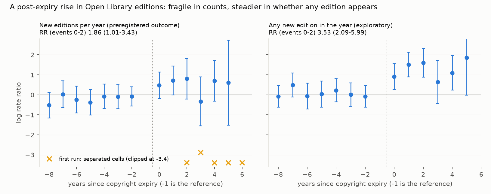
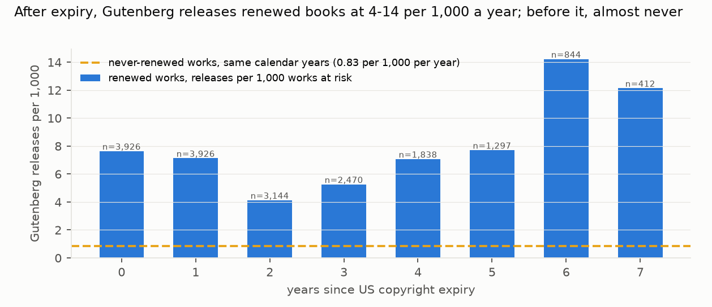

# Does Public Domain Day unlock new editions? The preregistered edition count is too fragile to call, but newly freed books become about three times as likely to get some new edition, and Project Gutenberg picks them up

*US books registered in 1923–1930: renewed books, whose copyright expired on 1 January 2019–2025, against same-vintage
never-renewed books, in the public domain since the 1950s. Registrations come from the Catalog of Copyright Entries
(NYPL XML) and renewals from the NYPL renewal files. Open Library editions are linked through works (2026-09-30 dumps).
The plan was committed before any edition was linked or counted. This version includes fixes made after independent
review (D2).*

**Verdict: Inconclusive.**
- **H1, the preregistered count outcome:** it passes the rule only after a post-result fix (D1), and then rests on a
  single cohort.
- **Exploratory, after review:** the chance that a book gets *any* new edition rises robustly.
- **Project Gutenberg:** a clear expiry response.

- **H1 (expiry raises new Open Library editions by at least 50%).**
  - **The preregistered estimator** as first run returned RR 0.33 (0.19–0.58; original renewal flags). It is
    degenerate: cohort × event-time cells with no editions at all (five of the seven in 2025) push PPML coefficients
    towards −∞.
  - **After dropping separated cells** (D1, the standard ppmlhdfe convention, decided after the first result was
    seen), RR is **1.86** (1.01–3.43), with a clean pre-trend (Wald p = 0.78). The rule calls it Supported.
- **That number is fragile** (post hoc checks, D2):
  - **The 2024 cohort.** Without it, RR is **1.12** (0.61–2.07). Without any other single cohort it stays 1.65–2.56.
  - **Thin recent years.** That cohort's post period falls in 2024–2025, when Open Library recorded only 53 and 15
    editions across all linked works. Restricting to calendar years ≤ 2023 gives **0.95** (0.50–1.77); ≤ 2022 gives
    1.02.
  - **Planned variants,** after correctly dropping cohorts with an empty reference year (D2):
    - excluding print-on-demand publishers: 1.38 (0.53–3.62);
    - an ingestion-lag filter: 1.10 (0.55–2.18);
    - the placebo (expiry 3 years earlier): 1.06 (0.68–1.66).
  - **The earlier claims were wrong.** The previous version's "RR 794" and "failing pre-trends" were an unhandled
    separation of the reference year, not evidence against H1.
- **Exploratory: any new edition in the year.** RR **3.53** (2.09–5.99), with a flat pre-trend (p = 0.73).
  - **Robust:** without any single cohort, 2.58–4.63; years ≤ 2023, 2.29 (1.32–3.96); lag filter, 3.01; excluding
    reprints, 3.44.
  - **Weaker or null:** excluding print-on-demand gives 2.26 (0.93–5.51); the placebo is 0.84.
  - **Capped counts** (at most 5 editions per work-year) give 2.81 (1.60–4.95).
  - **Why counts are fragile:** single works flood single years with print-on-demand editions.
- **OLS on log(1 + editions),** relative to the treated pre-period mean (0.0059):
  - Sun–Abraham: +62% (−14% to +137%);
  - two-way FE: +91% (+43% to +139%).
  - Neither contradicts H1. The previous version wrongly called them "tiny".
- **Project Gutenberg responds.**
  - Renewed works were almost never released before expiry (7 of 3,926), then at 4–14 per 1,000 works per year.
  - Never-renewed works over the same years: 0.83 per 1,000 per year.
  - Within two years of expiry: 1.81% against 0.25%.
- **The linkage undercounts treated books.**
  - Precision is high: 73 of 74 judgeable links are correct.
  - Recall among shown candidates is 0.29 for renewed books and 0.50 for never-renewed ones. Popular books often have
    duplicate Open Library records, and 60% of renewed against 44% of never-renewed registrations with a passing
    candidate are dropped as ambiguous.

## In plain terms

Every 1 January, a new year of American books enters the public domain. For books from the 1920s, that only
happened if the publisher had bothered to renew the copyright. Most never did, so those books have been free for
decades. That gives a natural comparison: when a renewed book's copyright finally expires, do new editions appear,
compared with similar old books that were already free?

We linked about 30,000 registered books from 1923–1930 to Open Library, the largest open book catalogue, and looked
at new editions each year. The data are thin: only about 1,100 of the books had any new edition in 2008–2025, and the
catalogue has barely recorded the last two years.

Counting editions, which is what we planned to measure, gave an 86% rise after a standard fix made once we had seen
the first answer. But that rise comes almost entirely from the books freed in 2024, and a few cheap print-on-demand
reprints of single titles. Take those away and the count shows nothing either way.

A simpler question gives a steadier answer, though we only asked it after an independent reviewer suggested it: does
a book get any new edition at all in a given year? Newly freed books were about three times as likely to, and that
held under every check except dropping print-on-demand publishers.

Project Gutenberg, the volunteer e-book library, almost never released these books while they were in copyright,
then started releasing them at several times the rate of comparable books that were already free.

## What was asked

The lead (`legal-digital-humanities-public-domain-day-renewal-did`) asked what the annual US copyright expiries since
2019 unlock. The design uses renewal status to form the control group.
- **Prior work is cross-sectional:** Reimers on bestsellers before and after 1923, and Heald on Amazon editions by
  decade.
- **No event study** of the annual expiries with a renewal-based control was found.

## How it was done

- **Registrations and renewal.**
  - The data are 94,683 A-class book registrations for 1923–1930.
  - A registration is renewed if three conditions hold:
    - its number matches a renewal's original registration number;
    - the dates are within a year;
    - the titles match, with token-set similarity at least 60 (D2: renewal titles taken from the full entry text when
      the title field is empty, and author-name prefixes ignored).
  - Renewed shares are 17–20% per year.
- **Linkage to Open Library works:**
  - blocking on the first two title tokens (the plan said surname plus first token; D2);
  - title similarity at least 90, with the author surname present;
  - the work's first publish year no later than registration year + 1 (85.5% of linked works have none);
  - ambiguous registrations dropped.

  30,705 registrations are linked (4,671 of them renewed), of which 30,329 have registration years in range.
- **Outcome.** Open Library editions per work per publish year, 2008–2025.
- **Model.** PPML with work and year fixed effects and saturated cohort × event-time dummies (Sun–Abraham):
  - event time is binned to [−8, +6], with −1 as the reference;
  - RR is the cohort-weighted average over events 0–2;
  - the pre-trend is the Wald test on events −5 to −2;
  - standard errors are clustered by work;
  - separated cells (D1) and cohorts with an empty reference year (D2) are dropped.
- **Validation.** 300 registrations (150 renewed, 150 not) were labelled by a separate agent. It saw up to 8
  lettered candidates and not the matcher's choice.

## Results

### H1 and the exploratory outcome (`results/figures/F1_event_study.png`)

| outcome and run | RR (events 0–2) | 95% CI | pre-trend p | treated works |
|---|---|---|---|---|
| count, preregistered estimator, first run (original renewal flags) | 0.33 | 0.19–0.58 | 0.66 | 184 |
| **count, D1 (primary as reported)** | **1.86** | **1.01–3.43** | 0.78 | 191 |
| count, without the 2024 cohort (post hoc) | 1.12 | 0.61–2.07 | 0.33 | 163 |
| count, calendar years ≤ 2023 (post hoc) | 0.95 | 0.50–1.77 | 0.33 | 148 |
| count, excluding print-on-demand (D1 + D2; cohorts 2022–24 unidentified) | 1.38 | 0.53–3.62 | 0.42 | 85 |
| count, ingestion lag ≥ 12 months (D1 + D2; cohort 2025 unidentified) | 1.10 | 0.55–2.18 | 0.35 | 133 |
| count, placebo, expiry 3 years earlier | 1.06 | 0.68–1.66 | 0.15 | 131 |
| any new edition (exploratory) | 3.53 | 2.09–5.99 | 0.73 | 191 |
| any new edition, without the 2024 cohort | 2.58 | 1.56–4.28 | 0.37 | 163 |
| any new edition, calendar years ≤ 2023 | 2.29 | 1.32–3.96 | 0.30 | 148 |
| any new edition, excluding print-on-demand | 2.26 | 0.93–5.51 | 0.95 | 85 |
| any new edition, placebo | 0.84 | 0.56–1.26 | 0.07 | 131 |

The full grid (three outcomes × leave-one-cohort-out, year limits, the reprint exclusion, no print-on-demand, lag,
placebo) is in `results/tables/sensitivity.csv`.

- **Event time** (count, D1): +0.47, +0.71 and +0.80 log points at events 0, 1 and 2. None is individually
  significant at 5% (event 1: z = 1.95).
- **Separated cells dropped by D1:**
  - 2019 at +6;
  - 2020 at −7 and +5;
  - 2021 at +2 and +4;
  - 2022 at +3;
  - 2023 at +2.
- **By cohort** (count, each cohort against all controls; 21–35 treated works each):

  | cohort | RR |
  |---|---|
  | 2019 | 0.94 |
  | 2020 | 2.58 |
  | 2021 | 0.37 |
  | 2022 | 3.45 |
  | 2023 | 0.95 |
  | 2024 | 56 |
  | 2025 | 0.39 |

  The 2024 cohort's reference year holds 1 edition across its 674 linked works, and its expiry year 19, nine of them
  from one work.
- **Reprints.** 17 of the 65 treated works with a known first-publish year were first published before their
  registration, so their 1920s registration covered a new edition, not the text. Excluding them gives a count RR of
  1.93 (0.87–4.29).
- **OLS on log(1 + editions):**
  - **Sun–Abraham** (as planned): +0.0037 (−0.0008 to +0.0081), which is +62% (−14% to +137%) of the treated
    pre-period mean.
  - **Two-way FE** (post 0–2 and later indicators): +0.0054 (SE 0.0015), which is +91% (+43% to +139%).

### Project Gutenberg and HathiTrust (`results/figures/F2_gutenberg.png`)

- **Gutenberg.**
  - 336 linked works are on Gutenberg: 3.3% of renewed 1923–1929 works against 0.77% of never-renewed ones.
  - **Before expiry,** 7 of 3,926 renewed works had been released.
  - **After expiry,** releases run at 7.6, 7.1, 4.1, 5.3, 7.1, 7.7, 14 and 12 per 1,000 works at risk in years 0–7.
    Long lags are seen only for the oldest cohorts, and there is no early burst once rates are normalised.
  - **Never-renewed works** over the same calendar years: 0.83 per 1,000 per year.
  - **Within 0–2 years of expiry:** 1.81% of renewed works against 0.25% (the comparison sets a more popular group
    against a less popular one).
  - **By cohort,** the 2-year share is 5.1% for 2019, falling to 0.8% for 2025, whose window is truncated.
- **HathiTrust** (2026-10-01 snapshot).
  - 98.8% of matched volumes of renewed 1923–1929 books are full view, against 99.5% for never-renewed books.
  - The 1930 cohort, nine months after its expiry, is at 94.4%, against at least 99.3% for every older cohort.
    HathiTrust opens volumes at expiry and is still catching up on the newest year.

## What this does and does not show

- **Inconclusive for the preregistered count outcome.**
  - The only rule-passing estimate needs a post-result fix (D1) and depends on one cohort.
  - The catalogue's coverage of 2023–2025 editions (143, 53 and 15) is too thin for the late cohorts' post periods.
- **Exploratory evidence of a real but modest response.**
  - Whether a freed book gets any new edition in a year roughly triples, across cohorts and restrictions.
  - Gutenberg and HathiTrust both act at expiry.
  - The binary outcome was chosen after review, so it is a lead for a preregistered follow-up, not a confirmation.
- **Undercounting.** Linkage misses renewed, more popular books more often, which undercounts the outcome where it
  matters most.
- **Not shown:**
  - commercial editions outside Open Library (Amazon or WorldCat);
  - readership;
  - effects for renewed books not linked at all.

## Process and deviations

- **Preregistration:** `plan.md`.
- **Deviations** (`deviations.md`):
  - **D1 (post-result):** PPML separation handling.
  - **Data fix:** the Gutenberg catalogue had been truncated by the server and was re-fetched to full size.
  - **D2 (post-result, after independent review):**
    - renewal matching (title fallback and author-prefix handling; 1,278 registrations reclassified);
    - reference-year separation;
    - leave-one-cohort-out, year-limit and reprint sensitivities;
    - the exploratory binary and capped outcomes;
    - OLS on a relative scale;
    - corrected validation scoring;
    - Gutenberg rates per work at risk;
    - an unlogged blocking deviation.
  - The first-version tables are in `results/tables/v1_pre_review/`.
- **Independent review:** Fable, "fix first" (`review/review.md`). This version addresses it; a confirmation pass is
  queued.

## Reproducing it

1. `code/registrations.py`.
2. `code/pget.py`, for the dumps.
3. `code/link.py works`, then `authors`, `resolve` and `editions`.
4. `code/validate_links.py sample`, labelling, then `code/validate_links.py score`.
5. `code/did.py primary|nopod|lag|placebo|ols|binary|cells|sensitivity`.
6. `code/secondary.py`.
7. `code/figures.py`.
