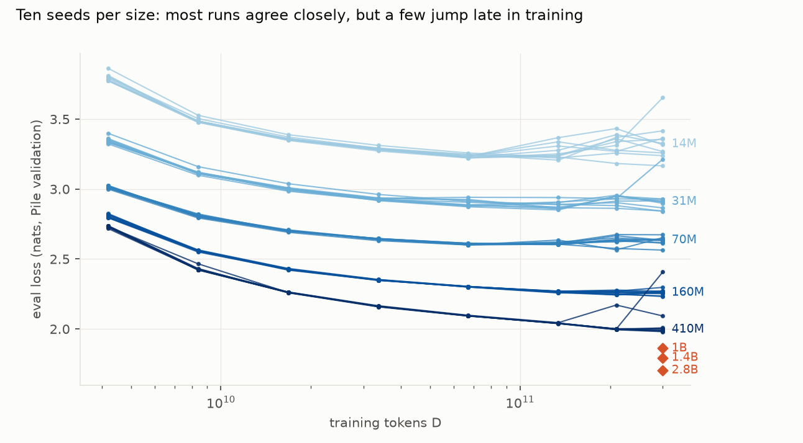
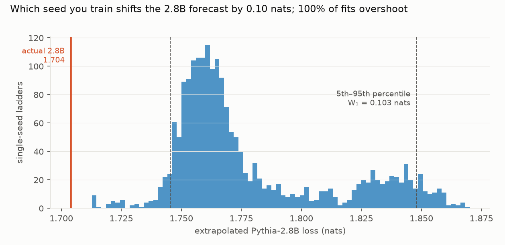

# Training-seed noise in scaling-law forecasts: one seed per size moves the 2.8B forecast by 0.10 nats, mostly because of two known outlier runs, and averaging three seeds did not clearly help

*PolyPythias: ten training seeds at each of five sizes, 14M to 410M, eight checkpoints each, 400 checkpoints in all.
Each was evaluated in fp32 on 5.0M tokens of Pile validation. The Chinchilla law was fitted to 2,000 random
single-seed ladders and to 2-, 3- and 5-seed averaged ladders, each extrapolated to Pythia-2.8B. N is the
preregistered non-embedding parameter count; a first run counted the output head too and was corrected after review
(D3). The plan was committed before any model was evaluated.*

**Verdict: H1 Inconclusive; H2 Inconclusive.**

- **H1 (single-seed ladders are too noisy: the 5th–95th percentile range W₁ of the 2.8B forecast exceeds 0.05
  nats): Inconclusive.**
  - W₁ = **0.103 nats**. The seed bootstrap interval is 0.041–0.119, so its lower end is below the bar.
  - **The 410M seed explains 77% of the forecast variance.** Ladders using 410M seed 3 or 4 have median forecasts of
    1.844 and 1.831, against 1.757–1.765 for the other eight seeds.
  - **These two seeds are known outliers.** The PolyPythias authors already identify them as the only outlier runs,
    with loss spikes. Without them, the 1,578 remaining ladders have W₁ = 0.050 (post hoc).
- **H2 (averaging three seeds per size at least halves the width): Inconclusive.**
  - The shrinkage is **0.10**, with an interval from −0.13 to 0.81: W₃ = 0.093 against W₁ = 0.103. Five seeds give
    0.077.
  - Averaging dilutes a bad run rather than removing it, so the heavy tail survives. Independent Gaussian noise would
    predict a shrinkage of 0.42.
- **The forecasts overshoot the real 2.8B loss, but by an amount that depends on how N is counted.**
  - With the preregistered non-embedding N, every single-seed forecast lies above the actual 1.704 nats; the median
    error is +0.061.
  - With total parameters, the median error is +0.017, and 67% overshoot (post hoc).
  - The fitted asymptote E is poorly identified under the preregistered N (5th percentile 0.16 nats), so the
    extrapolation rests on an ill-conditioned parameter.
  - The bias is shared across seeds, but its cause is not established (see below).
- **Seed matters more than fitting choices.** In a seed × procedure decomposition of the forecast, the seed accounts
  for 85% of the variance, the procedure 4% and their interaction 11%.

## In plain terms

Before training a large AI language model, labs train a ladder of small ones and fit a "scaling law" to predict how
good the big one will be. Each small model starts from a random seed, and different seeds give slightly different
models. We asked how much that luck moves the prediction.

Using a public set of models trained ten times each with different seeds, we fitted thousands of ladders, each using
one seed per size. Which seeds you happen to get moves the prediction for a model with about 8 times the parameters
of the largest rung by about 0.10 in the loss units used. That is comparable to the real gap between the 1.4-billion
and 2.8-billion-parameter models (0.09).

About three-quarters of that variation comes from which seed is used at the largest rung, and almost all of that
from two training runs the models' authors had already flagged as unstable. In this data, dropping those two runs would have cut the spread to about 0.05. Whether
inspecting training curves beats averaging in general was not tested. Averaging three seeds per size helped little
here, though that estimate is very uncertain.

The predictions also came out worse than the big model actually was. How much worse depends on a bookkeeping choice,
whether the model's embedding parameters are counted, so that bias should not be read as a property of the scaling
formula alone.

## What was asked

The lead (`llm-ml-science-scaling-fit-seed-uncertainty`) asked how much training-seed variation moves a
scaling-law extrapolation, and whether three seeds per size fix it.
- Prior work varies the fitting procedure or the seeds of the fit itself, not training seeds across a ladder.
- The PolyPythias paper documents seed variation in training dynamics and identifies outlier runs, but not their
  effect on extrapolation.

## How it was done

- **Evaluation.**
  - 5,000,000 tokens of `pile-uncopyrighted` validation (SHA-256 `e276f22a…`), in 2,048-token sequences.
  - Mean token cross-entropy in fp32. bf16 corrupts late Pythia checkpoints, so D1 replaced it before any fit.
  - Pythia-2.8B was evaluated in fp16 beside the shared GPU server. Its fp16–fp32 difference at 1B and 1.4B is at
    most 6×10⁻⁵ nats.
- **Ladders.** Sizes 14M, 31M, 70M, 160M and 410M; seeds 0–9; steps 2k–143k, so D runs from 4.2B to 300B tokens.
- **N.** Non-embedding parameters from each config, L(12d² + 13d) + 2d (D3). Total parameters are a post hoc
  sensitivity.
- **Fits.** Chinchilla L = E + A/N^α + B/D^β, by a Huber loss (δ = 10⁻³) on log L from 64 starting points, as in
  Hoffmann et al. and Besiroglu et al.
- **Ladders sampled.** 2,000 single-seed ladders, and 2,000 n-seed averaged ladders for n = 2, 3, 5.
- **Intervals.** A bootstrap over seeds within size (200 × 500 ladders).

## Results

### The ladder (`results/figures/F1_ladder.png`)

- **Small models rise late, except the original runs.**
  - At 14M, all nine new seeds end above their minimum loss, by up to 0.43 nats; at 31M, seven of nine do, by up to
    0.28.
  - The original seed-0 runs at both sizes fall monotonically.
  - Saturation of small language models (Godey et al., 2024) is one possible explanation. It is a hypothesis here,
    and the seed-0 exception is unexplained.
- **Two 410M runs jump:**
  - seed 3 at 100k steps (2.17 against 2.00), partly recovering by 143k (2.09);
  - seed 4 at 143k (2.41).

  These are the two runs the PolyPythias authors flag as outliers.
- **Seed SD of the final loss:** 0.133 (14M), 0.106 (31M), 0.029 (70M), 0.019 (160M), 0.132 (410M). Without the two
  jump runs, the 410M SD is 0.010.

### Forecasts of Pythia-2.8B (`results/figures/F2_extrapolation.png`)

| seeds averaged per size | W (5th–95th, nats) | median error vs actual 2.8B |
|---|---|---|
| 1 | 0.103 (0.041–0.119) | +0.061 |
| 2 | 0.091 | +0.060 |
| 3 | 0.093 (0.016–0.102) | +0.059 |
| 5 | 0.077 | +0.066 |
| 1, excluding the two 410M outlier runs (post hoc) | 0.050 | +0.058 |
| 1, checkpoints up to step 64k (post hoc) | 0.084 | +0.119 |
| 3, checkpoints up to step 64k (post hoc) | 0.021 | +0.121 |
| 1, N = total parameters (post hoc) | 0.160 | +0.017 |

### Secondary analyses

- **Accuracy at 1B and 1.4B (single seed):** median errors +0.055 and +0.066, with widths 0.070 and 0.081.
- **Fitted exponents (5th, 50th, 95th percentiles):** α 0.086, 0.104, 0.138; β 0.786, 0.881, 1.059.
  - β is far above the Chinchilla paper's 0.28, as expected when the data dimension is a single run's checkpoints.
  - Under total N, α is 0.20, 0.25, 0.30, so α depends strongly on the N convention.
- **Procedure against seed** (300 ladders × 5 procedures): seed 85%, procedure 4%, interaction 11%. The widths are:
  - base 0.101;
  - Huber δ 10⁻⁴: 0.106;
  - Huber δ 10⁻²: 0.104;
  - linear-space fit: 0.106;
  - a 16-start grid: 0.114.

  The 64-start fits are at the optimum: the independent review found that denser grids do not move them. So the
  16-start widening is a sparse grid stopping in worse local optima, not a modelling choice.
- **Final checkpoints only** (N-only law): W₁ 0.607, median error −0.029. Five points cannot pin the law.
- **Evaluation noise.** The forecast and the target are scored on the same tokens, so the relevant noise is the paired
  document-bootstrap SD of the difference between two models' losses:
  - 0.0076 nats for 2.8B against 410M seed 0;
  - 0.0027 for 2.8B against 1.4B.

  The seed spread and the overshoot are many times larger than evaluation noise.

## What this does and does not show

- **Seed noise in a small ladder is heavy-tailed.**
  - Most seeds agree to about 0.01–0.03 nats at 70M–410M.
  - The forecast spread comes mainly from two rare runs that destabilise late, and averaging dilutes but does not
    remove them.
  - Here those runs were already known as outliers. Dropping them would have cut the spread to about 0.05, but that
    is a post hoc observation on this data, not a tested rule. Robust aggregation, such as the median across seeds,
    was not tested.
- **The cause of the overshoot is not established.** It is shared across seeds, but its size depends on how N is
  counted (+0.061 non-embedding, +0.017 total). Candidate causes:
  - the N convention, and the poorly identified E;
  - the data dimension being intermediate checkpoints of one cosine-schedule run, whose losses are not those of runs
    trained to that D;
  - possible near-duplicates between Pile training and validation text, which a larger model could exploit more.
    That would lower the 2.8B loss relative to the ladder and look like overshoot. It cannot be quantified without the training
    set, and no leakage audit beyond the held-out split was possible (G1).
- **Not shown:**
  - **Other scales.** Ladders far beyond 410M, and seeds at the target scale (only seed 0 exists for 1B–2.8B).
  - **Data-order versus initialisation effects.** PolyPythias varies both together.
  - **Whether such outlier runs are typical** of other model families.

## Process and deviations

- **Preregistration:** `plan.md`.
- **Deviations** (`deviations.md`):
  - D1, before any fit: bf16 to fp32 evaluation.
  - D2: batch-size changes to avoid out-of-memory (recorded late, after the fits; no effect on any loss), and the
    post hoc checks.
  - D3, after the independent review: N corrected to the preregistered non-embedding count and every fit re-run, with
    a total-N sensitivity added.
- **Post hoc** (labelled):
  - `code/spike_check.py`, `code/posthoc.py`;
  - `code/sensitivity_total_n.py`, `code/posthoc_review.py`.
- **Independent review:** Fable, 2026-10-28 (`review/review.md`), verdict fix first. The fixes are above;
  confirmation pass to follow.

## Reproducing it

1. `code/evaluate.py corpus`, then `code/evaluate.py run` (about 6 h on one GPU), then
   `code/evaluate.py evalnoise`.
2. `code/fix_n.py` (non-embedding N from the configs).
3. `code/fit.py` (about 10 h on 20 cores).
4. `code/spike_check.py`, `code/posthoc.py` and `code/figures.py`.
5. `code/sensitivity_total_n.py` and `code/posthoc_review.py`.
