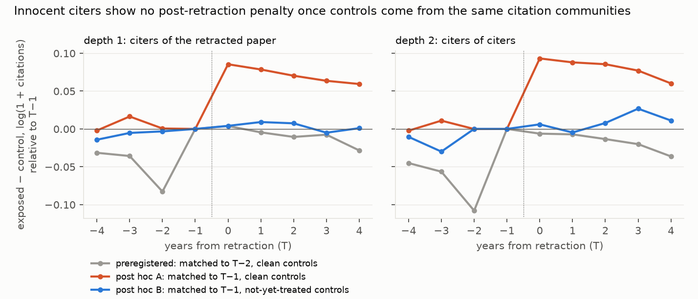

# Innocent citers of retracted papers suffer no measurable citation penalty in a post hoc comparison with not-yet-treated controls: the apparent effects come from comparing them with the wrong controls

*Retraction Watch retractions 2000–2021: 27,802 with a matched OpenAlex work and consistent dates, of which 6,222
have at least one innocent citer. 86,463 works cited a later-retracted paper before its retraction and share no
author or institution with it (depth 1), and 69,865 cite such a work (depth 2, sampled). The preregistered comparison
analyses 38,134 and 22,506 of them; the decisive post hoc comparison, 10,955 and 9,798. Citations per year come from
the full local OpenAlex snapshot. The plan and analysis code were committed before any citer or citation count was
built.*

**Verdict: by the preregistered rules, H1 Inconclusive, H2 Supported only vacuously (not interpretable) and H3
Refuted; post hoc design B finds no detectable penalty at either depth.**

- **H1 (unrelated depth-1 citers lose citations after the retraction): Inconclusive.**
  - The preregistered matched DiD is **+0.068 log points** (95% interval +0.054 to +0.082; 4,355 retractions):
    exposed works *gain* relative to their controls. Post hoc checks (below) show that this estimate is an artefact
    of the matching, so it says nothing about a penalty either way.
  - **Post hoc design B** compares citers with works that also cite retracted papers, but only papers retracted
    after the event window ("not-yet-treated" controls), matched on the trajectory to T−1. Its effect is **+0.003
    (−0.015 to +0.021)**, so no penalty larger than about 1.5% is detectable, and no gain.
- **H2 (the penalty is at least twice as large for misconduct as for honest error): Supported by the letter of the
  rule, vacuously.**
  - The preregistered contrast is C = 0.116 (0.026 to 0.205). It is positive only because both groups *gain* and the
    honest-error group gains more. The contrast assumes positive penalties, so it cannot be read as support; calling
    H2 not testable is a post hoc reading (D1).
  - Under design B the point estimates run opposite to H2: misconduct −0.000 (−0.021 to +0.020), honest error
    +0.054 (+0.006 to +0.105; 406 retractions). That honest-error gain is the only design-B interval that excludes
    zero.
- **H3 (the penalty attenuates to zero at depth 2): Refuted by the preregistered rule, with no penalty to
  attenuate.**
  - The preregistered depth-2 DiD is +0.088 (+0.073 to +0.102), which excludes zero.
  - Under design B, depth 2 is +0.010 (−0.005 to +0.026).
- **Why the naive comparisons mislead (post hoc checks): regression to the mean, not faster growth.**
  - Citers of later-retracted papers are more cited than same-venue, same-year papers that cite no retracted work:
    0.49 log points above their whole clean candidate pool in citations to T+4, but 0.06 below their not-yet-treated
    pool. Matching on one or two early years pairs each exposed work with a control that happened to have the same
    early count, and the control then falls back more than the exposed work.
  - The gap therefore opens in the first year the match leaves free. That year is T−1 when matched at T−2, so the
    gap looks like a pre-trend. It is T when matched at T−1 (design A), so it looks like a retraction effect.
  - On the same 6,056 exposed works, clean controls give +0.085 (+0.063 to +0.107) and not-yet-treated controls
    +0.008 (−0.015 to +0.029). The difference between the designs is the control group, not the sample.

## In plain terms

When a paper is retracted, do the scientists who innocently cited it, people with no connection to the authors,
pay a price in fewer citations to their own work? Earlier studies found a penalty for the retracted authors' other
work and for closely related papers, but no study we found had estimated the effect on innocent citers across all of
science.

We found about 86,000 such citing papers, and 70,000 papers one step further removed. A first, preregistered
comparison, of the 38,000 citing papers we could pair with a similar paper from the same journal and year, suggested
the citers actually *gained* citations. But the comparison was flawed. Papers that cite soon-to-be-retracted work are
more cited than typical papers in the same journal, so pairing them by their early citations finds partners that were
having an unusually good start, and those partners then fall back.

In a check added after the first result, we instead paired about 11,000 citing papers with papers from the same
communities: ones that cited work retracted only years later. The difference vanished. Innocent citers neither lost
nor gained citations after the retraction, to within about 2%. This held for misconduct retractions too. The papers
we could pair are the less-cited ones, so a penalty confined to prominent papers would not show here. For the papers we
could pair, citing a paper that is later retracted does not, on this evidence, cost them citations.

## What was asked

The lead (`metascience-retraction-citer-contagion`) asked whether unrelated citers suffer collateral citation
damage, whether it is larger for misconduct, and whether it fades by citation depth 2. Prior work:
- the retracted authors' own work (Lu et al. 2013; Jin et al. 2019);
- topically related articles (Azoulay et al. 2015; a 5–10% decline);
- continued citation of retracted papers themselves (Hsiao and Schneider 2021);
- RealSpill (Zenodo, 2026), which builds a retraction-spillover benchmark on pre-event citations, not stratified by
  reason or depth.

## How it was done

- **Retractions.**
  - Retraction Watch "Retraction" records with original-paper DOIs resolved in the OpenAlex snapshot: 61,527 of
    61,848 DOIs over all years.
  - Kept: retraction year 2000–2021 with the retraction dated after the original: 27,802 (other 14,245, misconduct
    10,754, honest error 2,803). Of these, 6,222 have at least one depth-1 exposed work.
  - Reason classes are fixed in the plan: misconduct (fabrication, falsification, manipulation, plagiarism,
    duplication, paper mill, compromised review and others); honest error (only "Error in…" or "Results Not
    Reproducible"); other. The plan's list misses some misconduct labels (D2).
- **Exposed works.**
  - **Depth 1:** articles and reviews citing the retracted paper, published T−6 to T−2, sharing no OpenAlex author
    or institution with it, at each work's earliest exposure.
  - **Depth 2:** works citing a depth-1 work in the same window, citing no Retraction Watch-retracted work, with no
    overlap; up to 20 per retraction.
- **Citations per year** are counted for 2.7 million target works (exposed and candidates) from every reference list
  in the snapshot, self-citations included.
- **Designs.**
  - **Preregistered:** controls from the same source and year citing no retracted work, matched on citations to
    T−2 (caliper 0.25 log points). The DiD is the mean of T+1..T+4 minus the mean of T−4..T−2, averaged within and
    then across retractions. Works published at T−2 have no pre-period year and drop out.
  - **Post hoc A** (D1.3): the same controls, matched on the trajectory to T−1. The effect is the mean of T+1..T+4
    minus T−1.
  - **Post hoc B** (D1.4, specified before it was run): controls from the same source and year that cite retracted
    work, but only work retracted after T+4. Matching and the effect are as in A.
- **Intervals:** a cluster bootstrap over retractions (2,000 resamples).

## Results

### Event profiles (`results/figures/F1_event_profiles.png`)

| design | depth 1 effect (95% CI) | retractions | depth 2 effect (95% CI) | retractions |
|---|---|---|---|---|
| preregistered DiD | +0.068 (+0.054 to +0.082) | 4,355 | +0.088 (+0.073 to +0.102) | 3,827 |
| post hoc A (clean controls, matched to T−1) | +0.068 (+0.056 to +0.080) | 5,513 | +0.078 (+0.068 to +0.087) | 4,858 |
| **post hoc B (not-yet-treated controls)** | **+0.003 (−0.015 to +0.021)** | 3,203 | **+0.010 (−0.005 to +0.026)** | 3,520 |

| reason class, depth 1 | preregistered | post hoc B |
|---|---|---|
| misconduct | +0.060 (+0.044 to +0.078) | −0.000 (−0.021 to +0.020) |
| honest error | +0.088 (+0.044 to +0.132) | +0.054 (+0.006 to +0.105) |
| other | +0.079 (+0.053 to +0.103) | −0.017 (−0.055 to +0.021) |

- **The preregistered estimate is positive everywhere.** It is positive in every field (life sciences +0.053,
  health +0.071, physical +0.078, social +0.104) and in both eras (2000–2010: +0.080; 2011–2021: +0.067), and it is
  unchanged with exact matching on pre-period counts (+0.086). All these share the same control group.
- **Pre-period profiles.** In the preregistered design, the mean of T−4..T−2 relative to T−1 is −0.075 (depth 1)
  and −0.101 (depth 2). In designs A and B the pre-period years are matched by construction, so their flat
  pre-profiles cannot test parallel trends.

### Who is analysed (`results/tables/coverage.json`, `results/tables/selection.json`)

| design | depth-1 works analysed (of 86,463) | depth-2 works analysed (of 69,865) |
|---|---|---|
| preregistered | 38,134 (44%) | 22,506 (32%) |
| post hoc A | 38,536 (45%) | 36,779 (53%) |
| post hoc B | 10,955 (13%) | 9,798 (14%) |

- **Why works drop.**
  - Preregistered, depth 1: 27,954 were published at T−2 and have no pre-period year, 19,135 have candidates but
    none within the caliper, and 1,240 have no candidate.
  - Design B, depth 1: 37,209 have no not-yet-treated candidate in their source and year, and 38,299 have
    candidates but none within the caliper.
- **The analysed works are the less-cited ones.**
  - Mean log(1 + citations to T−1), analysed vs not, among works each design could analyse: preregistered 2.21 vs
    2.73, design A 1.65 vs 2.51, design B 1.78 vs 2.18. The gap holds within each publication age (−0.46, −0.68, −0.25).
  - The share analysed falls from the least- to the most-cited quarter: 74% to 51% (preregistered), 72% to 28% (A),
    18% to 10% (B).
  - Every estimate here describes the less-cited end of the citer population.

### What the naive designs pick up (`results/tables/posthoc_review.json`, `results/tables/gap_profiles.csv`)

- **The pools differ in level.** Unmatched, exposed works have 0.49 log points more cumulative citations to T+4
  than the average of their clean candidates (same source and year, citing no retracted work; 84,837 works). Against
  their not-yet-treated candidates the difference is −0.06 (49,254 works).
- **Preregistered pairs: the raw gap opens at T−1.** Exposed minus control log(1 + citations), for the pairs
  analysed: +0.005 (T−4), +0.013 (T−3), +0.001 (T−2, the matching year), then +0.083 (T−1), +0.087 (T), and
  +0.079, +0.073, +0.076 and +0.055 over T+1 to T+4. There is no divergence before the matching year: one step,
  which then slowly closes. In the balanced panel (12,716 pairs published by T−5), it is the control that moves:
  from T−2 to T−1 its mean log citations fall by 0.063, against 0.024 for the exposed works.
- **Design A: the step lands on T, and its size depends on how much the matched years reveal.**

  | exposed work published | pairs | change from T−1 at T | at T+2 | at T+4 |
  |---|---|---|---|---|
  | T−2 | 16,666 | +0.116 | +0.106 | +0.088 |
  | T−3 | 9,214 | +0.047 | +0.027 | +0.014 |
  | T−4 or earlier | 12,656 | +0.035 | +0.015 | +0.005 |

  For the youngest works, one or two years of citations say least about their long-run level, so their matched
  controls revert most. For works with a longer record the step is smaller (+0.035) and has almost gone by T+4
  (+0.005). A difference in growth rates would open a widening gap; this opens a step that closes.
- **Design B shows no step at any publication age.** The change from T−1 lies between −0.026 and +0.017 in every
  cell.

## What this does and does not show

- **No collateral penalty to innocent citers is visible.** Against controls from the same citation communities,
  their post-retraction citations track their peers to within about 1.5–2%, at both depths and for misconduct.
- **Naive designs are biased, through regression to the mean.**
  - Citers of retracted work are more cited over their lifetime than typical same-venue papers. Matching on one or
    two years of citations cannot remove that difference in level; the artefact simply moves to whichever year is
    left free.
  - This matters for any study of retraction spillovers that uses "clean" controls.
- **Limits.**
  - **The sample is selective** (above): a penalty confined to prominent citers would not be visible.
  - **Retractions invisible to Retraction Watch.** 7,778 articles and reviews from 1994–2019 that OpenAlex flags as
    retracted are not in the Retraction Watch match. Their citers count as citing no retracted paper, so they can be
    controls in every design, and design B cannot see their retraction dates. The direction of any bias is unknown.
  - **Reason classes.** The plan's label list misses some misconduct labels, so 184 of the 1,427 depth-1 "other"
    retractions would be misconduct under a fuller list (D2). The honest-error class is unaffected, and the review
    found that the misconduct estimate moves only at the third decimal.
  - **The no-overlap rule has a small loophole.** 3.9% of the retracted works have no OpenAlex author ids and 8.5%
    no institution ids. 0.7% and 2.3% of depth-1 exposed works attach to them, so for those "no overlap" cannot be
    tested.
  - **Multiple exposure.** 18.4% of depth-1 works cite more than one retracted paper, and 5.3% cite one retracted
    before T. On single-exposure works the estimates are unchanged (independent review: A +0.068; B +0.009,
    −0.009 to +0.027).
  - **Design B at depth 2 compares unlike works.** Depth-2 exposed works cite no retracted paper, but their
    controls are direct citers of later-retracted papers.
  - **Design B has thin pools and shared controls.** The median exposed work has 3 candidates, and 13,932 distinct
    controls serve 20,753 pairs (one up to 26 times). The bootstrap resamples retractions only, so its intervals are
    probably somewhat too narrow.
  - **Design B could be biased itself** if work retracted later is systematically different from work retracted
    earlier.
  - **Leakage (G1).** The independent review found that 0.9% of design-B controls cite a later-retracted paper by the
    same authors as r, and 1.9% one from the same institutions. Excluding them gives +0.002 (−0.015 to +0.020).
- **Not shown:**
  - **The honest-error gain.** The +0.054 is one subgroup among several, with 406 retractions and an interval that
    nearly reaches zero. It runs opposite to H2 and should not be over-read.
  - **Effects on other outcomes,** such as reputation, hiring or the content of later citations.
  - **Effects on papers that build heavily on the retracted result,** which reference lists cannot identify.
  - **Retractions after 2021.**

## Process and deviations

- **Preregistration:** `plan.md`, with the build and analysis code committed before outcomes. One crash fix
  (`R.T` to `R["T"]`) was made to `analyse.py` after the data existed; it has no analytic content (D2).
- **Deviations** (`deviations.md`):
  - **D1, after the primary results:**
    - the pre-period gap;
    - the uninterpretable H2 contrast;
    - post hoc design A;
    - post hoc design B, specified before it was run.
  - **D2, after the independent review:**
    - D1's "outgrow" reading is replaced by regression to the mean;
    - five implementation details the plan did not state;
    - the reason-class gaps;
    - the post-review scripts.
- **Independent review:** Fable, 2026-10-28 (`review/review.md`), verdict publish with edits. Every design reproduced
  exactly from the interim files. The edits are interpretation, sample reporting and limits; no estimate changed.
- **Gates:**
  - G2: `results/tables/coverage.json`, added after the review.
  - G3: `results/plausibility.md`, added after the review.
  - G5: `review/overclaim_check.md`.
  - G6: `results/attribution_ledger.csv`.

## Reproducing it

1. `code/run_build.sh`: Retraction Watch classes, then four snapshot passes (about 25 minutes on 14 cores).
2. `code/analyse.py`.
3. `code/posthoc.py`.
4. `code/posthoc_b.py select`, then `count`, then `analyse`.
5. `code/figures.py`.
6. After the review: `code/coverage_report.py` and `code/posthoc_review.py` (about 10 minutes each).
