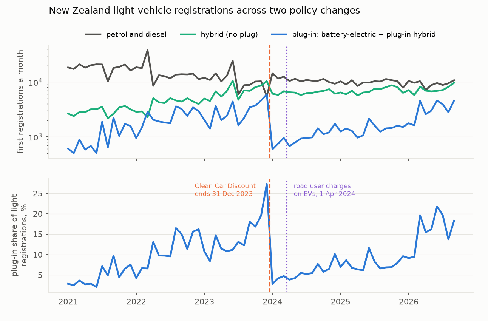
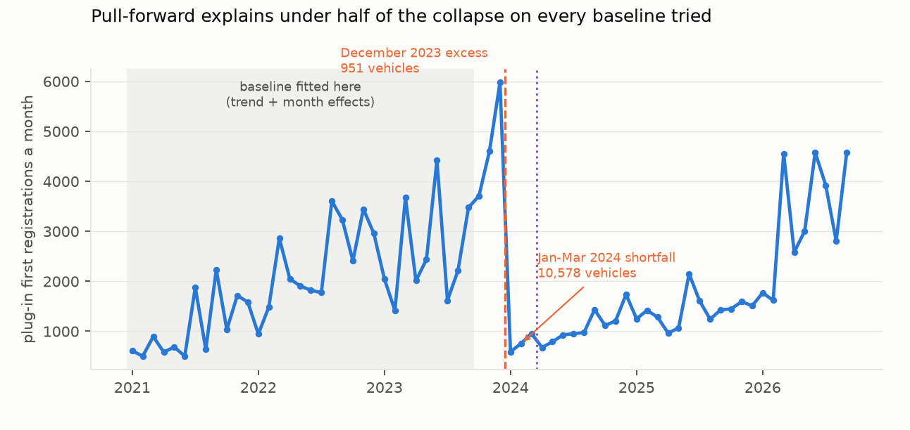
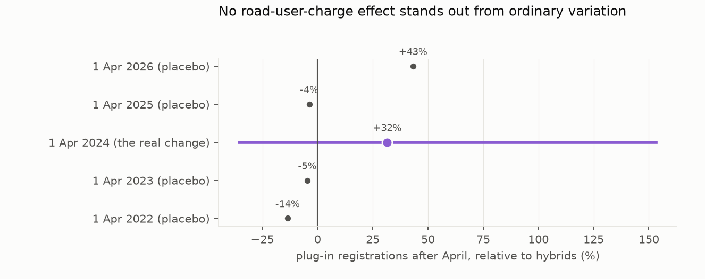

# Rebate or road charge? Separating two 2024 shocks to New Zealand's EV uptake

*1.4 million first registrations of light vehicles, January 2021 to September 2026, from New Zealand's Motor Vehicle
Register, used to tell apart two policy changes three months apart: the end of the Clean Car Discount on
31 December 2023 and the arrival of road user charges for electric vehicles on 1 April 2024.*

**Verdict: Inconclusive on both preregistered tests.** The data show a sharp fall in plug-in registrations, lasting about
two years, when the rebate ended and no detectable effect of road user charges, but neither test can give a
confident answer, and the road-charge comparison is confounded as well as underpowered.

- **H1 (the January 2024 collapse was mostly buyers registering early): Inconclusive, leaning against.** The ratio of
  the December 2023 excess to the January–March 2024 shortfall is 0.09 under the preregistered log-linear baseline (95%
  CI −0.40 to +1.07), where the hypothesis needs at least 0.5. The ratio depends heavily on the baseline: across
  defensible alternatives it runs from 0.09 to 0.46 (level-linear fitted from 2022), never reaching 0.5. The firmer
  argument is a break-even: for half the shortfall to be pull-forward, the counterfactual would have had to be no more
  than 2,850 plug-ins a month, against 4,156 actually registered in October–November 2023. With the test's minimum
  detectable effect near 1.0, it could only ever have supported a pull-forward larger than the whole shortfall.
- **H2 (road user charges did far less than the rebate's removal): Inconclusive, and the design cannot answer it.**
  After 1 April 2024, plug-in registrations moved **+32%** relative to non-plug hybrids (95% CI −35% to +153%). That
  comparison is confounded: plug-ins were rebounding from their January trough faster than hybrids before April, a
  rebound the difference-in-differences reads as a positive "effect"; battery-electric vehicles, which pay the full
  charge, rose 33% relative to plug-in hybrids, which pay half; and in a distribution of 38 placebo dates, 18 give a
  larger contrast than the real one.

**What the data show, whatever the tests return:**

- **The rebate's end is unmistakable; the road charge is not.** Plug-ins fell from 27.3% of light registrations in
  December 2023 to 2.8% in January 2024. Both months are distorted — buyers of high-emission vehicles held off until
  the fee ended, swelling January's total and shrinking December's — so a cleaner comparison is November to February:
  19.5% to 4.1%. Nothing comparable happens at April 2024.
- **The fall lasted two years.** Over January 2024 to December 2025 the plug-in share averaged 6.6%, against 13.4% in
  January–November 2023. A recovery began in March 2026: April–September 2026 averaged 17.5% (13.7–21.7% by month),
  above mid-2023. Like for like, January–September 2026 had 29,402 plug-in registrations against 23,293 in
  January–September 2023. What drove the 2026 recovery is not identified here.
- **The same deadline pushed ute buyers the other way.** The high-emission fee ended on the same day. Diesel
  utilities of 3,500 kg or less fell to 515 in December 2023, a quarter of their October–November level, then jumped to
  3,649 in January 2024. The same pattern recurs at the scheme's other fee dates (April 2022, July 2023).

## In plain terms

New Zealand ended its rebate for electric cars on 31 December 2023 and three months later started charging EV drivers
road user charges. EV sales fell off a cliff. Which change did it?

We counted every light vehicle registered in New Zealand from 2021 to September 2026, grouped by what powers it.

The rebate's end is unmistakable. Plug-in vehicles went from about one registration in five in November 2023 to about
one in twenty-five in February 2024. The road user charge left no mark we could find, but our way of looking for one
was not good enough to rule an effect in or out.

Some buyers rushed to register before the rebate ended, but probably well under half of the drop is explained that
way: most of it was people not buying. The slump lasted about two years, and plug-in sales only started climbing back
in 2026.

There is a neat check. The same law charged a fee on high-emission vehicles, ending on the same day. Diesel ute buyers
did the opposite of EV buyers: they waited. Ute registrations fell to a quarter of normal in December 2023, then more
than quadrupled in January. Same deadline, opposite incentive, opposite behaviour.

A study published in September 2026 measured the rebate's end in a different way and reached similar conclusions about
the fall and the early rush; ours adds the road-charge question and the 2026 recovery.

## What was asked

Two policy changes landed three months apart, and public debate attributes the EV slump to both. The study asks two
preregistered questions (`plan.md`):

- **H1:** how much of the collapse in early 2024 is buyers who simply registered early, before the rebate ended?
- **H2:** is the incremental effect of road user charges small — under a third of the rebate effect?

**The identification.** Non-plug hybrids lost their rebate at the same moment as plug-ins but were not moved to road
user charges, so they are a control for the road-charge shock, not for the rebate shock.

## What was already known

**Hoang (2026)**, a Research Square preprint from Victoria University of Wellington (doi:10.21203/rs.3.rs-11080967/v1,
CC BY), estimates the Clean Car Discount's removal by regression discontinuity on weekly *new* registrations from
December 2021 to December 2025. It reports a permanent fall of about 24.1 percentage points in battery-electric market
share and documents 1,206 vehicles brought forward in the final eight weeks. It does not consider road user charges.
The earlier draft of this study said only the preprint's title could be retrieved; its full text is openly available,
and the draft's claim that no study had quantified the December 2023 pull-forward was wrong.

What this study adds: the separation of the road-charge shock from the rebate shock, which the preprint does not
attempt; first registrations including used imports, and plug-in hybrids alongside battery-electric vehicles; and data
to September 2026, which show the 2026 recovery after the preprint's window closes. Over the preprint's own window the
two studies agree that there was no recovery.

## How it was done

**Data.** NZTA's Motor Vehicle Register through its ArcGIS service, which answers aggregation queries; counts were
obtained grouped by month, motive power, import status and vehicle type, and no vehicle-level record was retrieved.
The universe is passenger cars, vans and utilities: 1,419,410 first registrations. It includes about 37,300 vehicles
over 3,500 kg gross mass, nearly all diesel trucks; the H1 and H2 results are unaffected, and the ute series below is
restricted to 3,500 kg or less.

**Groups.** Plug-in (battery-electric plus plug-in hybrid, including extended-range electric) is treated; non-plug
hybrids are the control; petrol and diesel are context.

**Measures.** A baseline for the treated group (log registrations on a linear trend with calendar-month effects, fitted
January 2021 to September 2023); H1 compares the December 2023 excess with the January–March 2024 shortfall; H2 is a
difference-in-differences against hybrids across 1 April 2024, excluding April. Intervals come from a residual block
bootstrap (2,000 resamples).

## Results

### The two shocks (`results/figures/F1_registrations.png`)

| month | plug-in registrations | plug-in share |
|---|---|---|
| November 2023 | 4,604 | 19.5% |
| December 2023 | 5,976 | 27.3% |
| January 2024 | 590 | 2.8% |
| February 2024 | 752 | 4.1% |
| June 2024 | 928 | 5.5% |
| June 2025 | 2,148 | 11.6% |
| June 2026 | 4,577 | 21.7% |
| September 2026 | 4,574 | 18.3% |

### H1: how much was pull-forward (`results/figures/F2_pullforward.png`)

| baseline | excess, Dec 2023 | shortfall, Jan–Mar 2024 | ratio |
|---|---|---|---|
| **log-linear, 2021-01 to 2023-09 (preregistered)** | **951** | **10,578** | **0.09** |
| Poisson, same window | 1,521 | 9,115 | 0.17 |
| level-linear, same window | 2,399 | 7,746 | 0.31 |
| log-linear, 2022-01 to 2023-09 | 2,456 | 5,614 | 0.44 |
| level-linear, 2022-01 to 2023-09 | 2,620 | 5,727 | 0.46 |
| local level anchored on Oct–Nov 2023 | 1,412–1,721 | 7,520–9,397 | 0.15–0.23 |
| new vehicles only (preregistered robustness) | −664 to 1,288 | 6,650–9,929 | −0.07 to 0.19 |

The preregistered log-linear baseline is the most aggressive extrapolation (it predicts 4,291 a month for early 2024,
above the October–November actuals), so 0.09 is a lower end, not a central estimate. No baseline reaches 0.5; the
review's alternative bootstraps put the probability of R ≥ 0.5 at 9–16%. **H1 is Inconclusive**, and the evidence
leans against it through the break-even above.

### H2: no detectable road-user-charge effect, and a design that could not find one (`results/figures/F3_ruc_did.png`)

- **Preregistered:** +32% (−35% to +153%); Q = 0.16 (0.01 to 0.53). **H2 is Inconclusive.**
- **The confound.** In the pre-window, plug-ins were climbing out of their January trough at about +0.24 log points a
  month against +0.05 for hybrids. That rebound reads as a positive post-April "effect", and it grows with the post
  window (+42% to +54% for longer windows). The "wrong sign" is what the confound predicts.
- **Within plug-ins.** Battery-electric vehicles, which pay the full charge, rose 33% relative to plug-in hybrids,
  which pay half — again the wrong sign for a deterrent.
- **Placebos.** The draft compared the real date with 1 April in 2022, 2023, 2025 and 2026, calling them dates with no
  policy change; they are not — 1 April 2022 is when the full Clean Car Discount began, and rebate cuts took effect on
  1 July 2023 within that year's window. A broader distribution of 38 placebo dates clear of October 2023–October 2024
  has a standard deviation of 0.38, and 18 of 38 exceed the real contrast in size.
- **A contaminated control.** "Diesel hybrid" — mild-hybrid utilities — rose from almost none to about 450 a month in
  May–October 2024; excluding it moves the estimate from +32% to +41%.
- **On market shares** rather than counts, the contrast is −1.7 percentage points, the opposite sign.

## What this does and does not show

- **It shows** an abrupt fall in plug-in registrations at the rebate's end, most of it not explained by early
  registration, lasting about two years before a 2026 recovery; and no visible road-user-charge effect.
- **It does not measure the road-user-charge effect.** The test is confounded by the rebound from the January trough,
  underpowered, and its placebo dates were not policy-free.
- **It cannot separate the rebate's end from everything else that changed that day**, including the high-emission fee's
  removal.
- **The register is a snapshot of vehicles still registered in September 2026.** Comparing it with NZTA's May 2023
  snapshot, about 95–96% of vehicles first registered in 2021–2023 survive (97–99% of plug-ins, about 99% of new
  vehicles, 89–93% of used imports): a gradient of about a point a year, which cannot produce the December 2023 spike or
  the 2026 recovery.
- **Counts are first New Zealand registrations**, so for used imports the month is the import's registration.
- **No personal data.** Counts only, aggregated by the register's own service.

## Process and deviations

- **Preregistration.** `plan.md` was committed before any registration series was built.
- **Code before outputs.** `fetch.py` and `analysis.py` were committed before their outputs; `figures.py` was written
  after the results.
- **D1** records the 2026 placebo and the window. Its first item, that the register ran to September 2026, was not a
  deviation: the plan already said so.
- **D2 (after independent review)** records the corrected account of the prior preprint, the reframed H1 and H2
  findings, the corrected placebo description, the light-vehicle ute series, and the preregistered analyses the draft
  omitted (new vehicles only, a market-share outcome, the minimum detectable effect for H1).
- **Review.** An independent adversarial review (`review/review.md`) matched the counts to NZTA's service cell for cell
  and reproduced both verdicts exactly; it found several framing claims wrong, all corrected here.

## Reproducing it

`code/fetch.py`, then `code/analysis.py`, then `code/figures.py`. The post-review analyses are
`review/reviewer_checks/reanalysis.py`, `verify_counts.py` and `attrition_snapshots.py`.

- **Inputs** are aggregation queries against NZTA's `MVR_Mar26` FeatureServer.
- **Results** are in `results/tables/`: `primary.json`, `monthly.csv` and `placebos.csv`.
