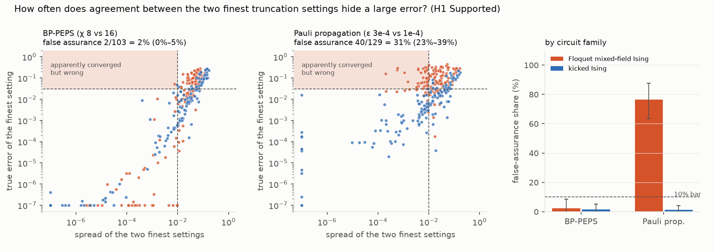

# When two truncation settings agree, is the answer right? In 300 exactly solvable circuits, Pauli propagation's agreement misled 31% of the time, mostly on loop-rich Floquet circuits; BP-PEPS's 2%

*300 heavy-hex patch circuits of 20–26 qubits (Floquet mixed-field Ising after the Quantum Advantage Tracker's model,
and kicked Ising) were simulated exactly by statevector and approximately by BP-PEPS (TensorNetworkQuantumSimulator.jl)
and sparse Pauli propagation (PauliPropagation.jl), on truncation ladders frozen from a separate pilot. An estimate is
"apparently converged" when its two finest settings agree within 0.01. The question is how often such an estimate is
still off by more than 0.03.*

**Verdict: H1 Supported. H2 Supported, but Pauli propagation's calibration fails within the Floquet family.**

- **H1 (more than 10% of apparently converged estimates are wrong by more than 0.03, for at least one method):
  Supported.**
  - **Pauli propagation (ε 3e-4 vs 1e-4):** 40 of 129 apparently converged estimates are wrong, **31%** (95%
    23–39%).
  - **BP-PEPS (χ 8 vs 16):** 2 of 103, **1.9%** (0–5.1%).
- **Where it happens.**
  - Pauli propagation's false assurance sits almost entirely in the Floquet circuits: **39 of 51 (76%; 64–88%)**,
    against 1 of 78 for kicked Ising. At 16 Floquet cycles, all 22 apparently converged estimates are wrong.
  - It is concentrated in patches containing loops: 34 of 66 hexagon-based patches, against 6 of 63 random patches.
  - **The verdict depends on that D1 design change.** On the plan's original random-growth patches alone, the share
    is 9.5% (3.1–17.4%), which would be Inconclusive. The hexagon-based half was added before any approximate result
    because random patches are often trees, but readers should weigh it (post hoc sensitivity).
  - **The cause is a shared bias.** In 85% of false-assurance cases the estimate is shrunk toward zero. Both
    thresholds discard weight in the same direction, so they agree with each other while both miss the truth.
- **H2 (a "k × spread" interval, with k fitted on half the instances, covers 85–95% of the other half, for both
  methods): Supported on the preregistered pooled test.**
  - BP-PEPS: k = 3.8, coverage **93%**.
  - Pauli propagation: k = 12.5, coverage **87%**, but only 79% within the Floquet family (94% for kicked Ising).
  - A single multiplier does not calibrate Pauli propagation across circuit types.
- **BP-PEPS's own diagnostics are informative:**
  - its gate-truncation error tracks the true error (Spearman 0.72);
  - its ladder spread tracks the true error more tightly than Pauli propagation's does (0.89 against 0.56).
- **D2:** the first analysis run accidentally compared the two coarsest settings. The fix and the buggy output
  (H1 Supported, H2 Inconclusive) are recorded.

## In plain terms

Computers that simulate quantum circuits approximately have a dial: turn it up and the answer gets more accurate, but
slower. A common way to decide an answer is trustworthy is to turn the dial up a notch and see whether the answer
changes. If it barely moves, people assume it has "converged". Classical entries in the public Quantum Advantage
Tracker are judged largely this way, without error bars.

We tested that habit on 300 small circuits whose true answers we could compute exactly. For one popular method, Pauli
propagation, about a third of the answers that looked converged were wrong by a meaningful amount. For the circuit type
modelled on a real tracker challenge, three-quarters were. The reason: as that method discards small terms, its answers
drift steadily toward zero, and a slightly finer setting drifts the same way, so the two agree while both are wrong.

The other method, a tensor-network approach, was rarely fooled in this way: when its two finest settings agreed, it was
almost always right. A simple rule of thumb ("the true error is usually within about 4 times the gap between the last two settings", which held for about 9 in 10 held-out circuits) gave it honest error bars.

## What was asked

The lead (`quantum-simulation-convergence-false-assurance`) noted the following:

- Almost all classical submissions to the Quantum Advantage Tracker (12 of 13 in its submissions file) report point
  values without error bounds, and are judged largely by whether truncation ladders agree.
- For the 51-qubit Floquet magnetization at 16 cycles, the tracker's notes list PEPS-BP (BD=700) at 0.442, two SPP
  settings at 0.411 and 0.387, and QESEM at 0.390 (0.369–0.412). They say neither classical method converges
  convincingly beyond about 12 cycles, across bond dimensions or truncation settings. (The lead's description of two
  PEPS-BP bond dimensions "agreeing closely" is not supported by those notes; G6.)
- Gharibyan et al. (arXiv:2507.10771) warn that tighter truncation does not always help, but nobody had measured how
  often apparent convergence is wrong over a population of exactly known instances.

## How it was done

- **Lattice and patches.** The heavy-hex coupling graph of the tracker's 74-qubit Floquet circuit, with its three edge
  colours.
  - Patches have 20, 22, 24 or 26 qubits.
  - Half grow at random from a seed qubit.
  - Half (D1) start from a hexagon and add adjacent hexagons, so that they contain the most loops the size allows
    (1–2). Random patches are often trees, on which BP has no loop error.
- **Families (150 each, stratified by 4 sizes × 4 depths, seed 20261025):**
  - **Floquet mixed-field Ising:** the tracker's angles (θ_x = 1.56567, θ_z = 0.33879, θ_zz = π/3), each scaled by
    U(0.7, 1.3), for 4–16 cycles;
  - **kicked Ising:** RX(θ) with θ ~ U(0, π/2), then RZZ(−π/2), for 5–20 layers.
- **Observable:** magnetization, starting from |0…0⟩.
- **Exact values.** qiskit-aer statevector in double precision (D1). An independent numpy statevector agrees to
  3 × 10⁻¹⁴ on 16 random 20-qubit instances, and both pass a dense-matrix test.
- **Approximations.**
  - **BP-PEPS:** `apply_gates` with maxdim χ, BP expectation values.
  - **Pauli propagation:** Heisenberg-picture propagation of M with coefficient threshold ε, then the overlap with
    |0…0⟩.
  - **Validation:** both reproduce exact values on small trees (BP at large χ, Pauli propagation at ε = 0).
- **Ladders, frozen on a separate 30-instance pilot (D1)** by the plan's rule that the finest setting must still have
  median error above 10⁻³:
  - BP χ ∈ {4, 8, 16} (χ = 32 and 64 were near-exact);
  - Pauli propagation ε ∈ {1e-2, 3e-3, 1e-3, 3e-4, 1e-4}.
  - All 2,400 main-set runs completed.

## Results (`results/figures/F1_false_assurance.png`)

| | BP-PEPS (χ 8 vs 16) | Pauli propagation (ε 3e-4 vs 1e-4) |
|---|---|---|
| apparently converged (spread ≤ 0.01) | 103 of 300 (34%) | 129 of 300 (43%) |
| … of which wrong by > 0.03 | **2 (1.9%; 0–5.1%)** | **40 (31.0%; 23.4–39.0%)** |
| Floquet / kicked Ising | 1 of 41 / 1 of 62 | **39 of 51** / 1 of 78 |
| random / hexagon-based patches | 2 of 72 / 0 of 31 | 6 of 63 / **34 of 66** |
| median true error, all instances | 0.014 | 0.030 |
| H2: k fitted, held-out coverage | 3.8, **93%** | 12.5, **87%** (Floquet 79%, kicked 94%) |
| median / slowest runtime at the finest setting | 1.7 s / 4.8 s | 4.4 s / 22 s |

Pauli propagation's apparently converged Floquet instances by depth: 1 of 7 wrong at 4 cycles, 11 of 15 at 8, 5 of 7
at 12, and 22 of 22 at 16.

**Exploratory (post hoc) threshold grid**, as the share of apparently converged estimates that are wrong:

| method | spread tolerance | error > 0.02 | error > 0.03 | error > 0.05 |
|---|---|---|---|---|
| BP-PEPS | 0.005 | 0% | 0% | 0% |
| BP-PEPS | 0.01 | 2.9% | 1.9% | 1.0% |
| BP-PEPS | 0.02 | 7.7% | 4.9% | 2.1% |
| Pauli propagation | 0.005 | 26% | 19% | 14% |
| Pauli propagation | 0.01 | 36% | 31% | 23% |
| Pauli propagation | 0.02 | 43% | 37% | 29% |

The conclusion does not depend on the preregistered thresholds.

## What this does and does not show

- **Agreement between truncation settings is weak evidence for coefficient-truncated Pauli propagation on Floquet-type
  circuits.**
  - The error is a systematic shrinkage toward zero. Refining ε reduces it slowly and in the same direction, so
    consecutive settings agree.  - The tracker's notes describe visible non-convergence for both PEPS-BP and SPP at large depth, not apparent
    convergence. This study's point is complementary: where coefficient-truncated Pauli propagation does look
    converged on Floquet-type circuits, it can still be biased.
  - A ladder spread says little here unless it is multiplied by a large, circuit-dependent factor.
- **Loops matter for Pauli propagation too.** Its false-assurance share rises with the number of loops in the patch:
  1 of 25 with none, 14 of 54 with one, 25 of 50 with two. The H1 verdict therefore leans on the loop-rich half of the
  design (random patches alone: 9.5%, 3.1–17.4%). Tracker-scale lattices have many more loops than either half.
- **BP-PEPS's ladder was honest at this scale.**
  - When χ = 8 and 16 agreed, the answer was almost always right, and the gate-truncation error is a useful warning
    light.
  - This is a statement about patches with at most two loops. Tracker lattices have many more loops, which is where
    BP's own approximation (not bond truncation) bites, and that is untested here.
- **Not shown:**
  - **Production scale.** Behaviour at 50–100 qubits and at production truncations (χ in the hundreds; Pauli
    propagation with weight caps) is not tested. Down-scaled ladders were chosen to keep the finest setting
    approximate.
  - **Other methods and observables.** Only magnetization was studied, with two families and two engines with their
    default options. The tracker's Operator Loschmidt Echo and SU(2) instances, and other truncation schemes (weight
    truncation, boundary-MPS contraction), are out of scope.
  - **Calibration across circuit types.** H2's pooled calibration should not be read as a general recipe: within the
    Floquet family it fails for Pauli propagation.

## Process and deviations

- **Preregistration:** `plan.md`.
- **Deviations** (`deviations.md`):
  - D1, before any approximate-method result:
    - qiskit-aer as the exact engine, with a numpy cross-check;
    - hexagon-based patches for half the instances;
    - a layer-wise 15-minute guard;
    - ladders frozen from the pilot by the stated rule.
  - D2, after the first results: the analysis code's finest-pair sort was inverted (it compared the coarsest pair).
    It was fixed, and the buggy output is kept as `results/tables/primary_v1_coarsest_pair_bug.json`.
- **Plan reading:** a method with fewer than 20 apparently converged instances could not decide H1. Both methods
  exceeded 20.
- **Independent review:** queued (Fable), per the lab's pacing rule.

## Reproducing it

1. Install Julia 1.11 with TensorNetworkQuantumSimulator.jl 0.4.6, PauliPropagation.jl 0.9.2, JSON3, NamedGraphs and
   Graphs (environment `/mnt/qsim/env`).
2. Create a Python venv with numpy, pandas, matplotlib, qiskit 2.6.1 and qiskit-aer 0.18.0.
3. Run `code/run_all.sh`: instances, exact values, ladders, cross-check, `analyse.py`, then `figures.py`.
