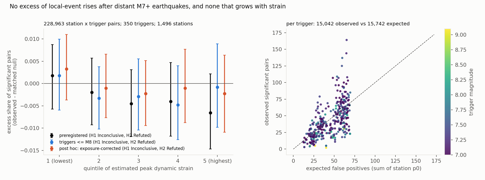
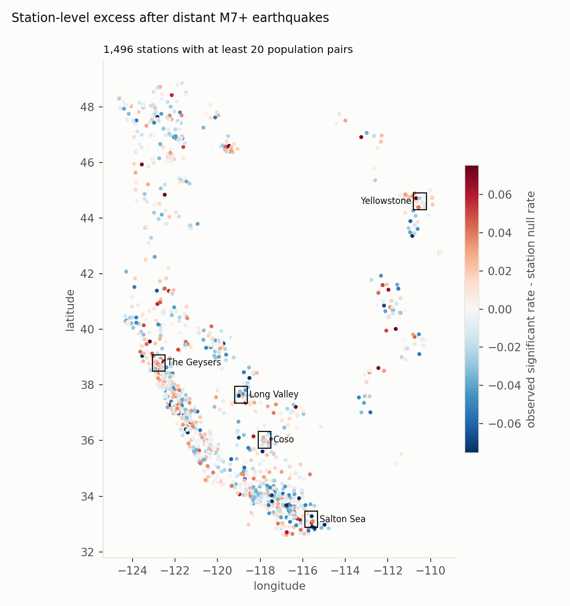

# No detectable remote dynamic triggering in the western US: after 350 distant M7+ earthquakes, rises in local events are no more common than at matched random times, and they do not grow with strain

*QuakeScope's 2026 PhaseNet picks for western-US stations (2.1 billion picks, 2002–2025) were turned into a
catalogue-free local-event proxy: P–S pairs confirmed at 3 stations within 50 km. For each global M ≥ 7 earthquake at
least 1,000 km away, each station's count in the 24 hours after the surface waves was tested against its 7-day
baseline. The rate of significant rises was compared with the same station's rate at 500 matched random times. The
plan and all analysis code were committed before any pick was counted.*

**Verdict: H2 Refuted; H1 Inconclusive.** There is no excess of significant rises overall. None appears at high strain
either, but the strain test's intervals are too wide to rule out a strain dependence by the preregistered rule.

- **H2 (remote triggering produces an excess of significant local-event rises): Refuted.**
  - Across 228,963 station × trigger pairs (350 triggers, 1,496 stations), 15,042 rises were significant against
    15,742 expected from each station's own rate at random times.
  - The mean excess is **−0.003** (95% two-way bootstrap −0.007 to +0.001), below the half-percentage-point bar.
- **H1 (the excess is at least 3 times larger in the top strain quintile, and absent in the bottom): Inconclusive.**
  - The top-quintile excess is **−0.007** (−0.015 to +0.002), and the bottom quintile's is +0.002 (−0.006 to +0.009).
  - Nothing rises with strain. Because the bottom quintile's excess is uncertain, though, the 3-times contrast
    (E5 − 3·E1: −0.012, −0.034 to +0.012) cannot be excluded.
- **Every robustness variant agrees** (H2 Refuted, H1 Inconclusive):
  - S−P of 0.8–5 s; confidence ≥ 0.7;
  - a 24-hour baseline; a post window from 6 h after the surface waves;
  - geothermal and volcanic areas excluded; triggers above M 8 excluded.
- **A masking artefact, checked post hoc (D1).**
  - The slight fall in excess with strain comes mainly from the proxy's removal of picks near predicted teleseismic
    arrivals. Great earthquakes' aftershocks remove more of the post window.
  - Correcting each window for the time removed moves the overall excess to −0.001 (−0.004 to +0.003) and the
    top quintile to −0.002 (−0.011 to +0.006).
- **During the surface waves themselves** (exploratory), local-event detections fall, by 1.4 percentage points in
  significant rises, rather than rise. Large waves hide small local events.
- **Per trigger, apparent triggering is common and uninformative.**  - Per trigger, the spread of observed minus expected is 10 times the variance that independent station outcomes
    would give.
  - 39 of 350 triggers sit more than 3 standard errors above expectation, and 55 more than 3 below.
  - A single trigger's excess cannot be read as triggering without a null that shares its timing across stations.

## In plain terms

When a very large earthquake strikes anywhere on Earth, its surface waves travel around the planet. Some studies have
claimed that these waves set off small earthquakes thousands of kilometres away, in places like California. Others
have argued that most such "triggering" is coincidence: small earthquakes happen all the time, so some will always
follow a big distant one by chance.

We used AI-detected earthquake arrivals at about 1,500 western-US seismometers with long, continuous records (of about
9,000 in the catalogue) over 24 years. For each of
350 distant earthquakes of magnitude 7 or more, we checked whether small local earthquakes picked up at each station
in the following day. Then we checked how often the same station shows such a pick-up at random times.

The answer is: no more often. Small local earthquakes followed the distant giants at the same rate as they follow
random moments. The rate also did not rise with the strength of the passing waves, as real triggering should.

Some single big earthquakes do look as if they set things off (39 of 350), but even more look as if they did the
opposite (55), and on average they match chance.
Triggering may still occur in particular places or for very small events this method misses. It is not a widespread effect across the western US that this method can detect.

## What was asked

The lead (`seismology-geophysics-dynamic-triggering-strain-test`) asked whether remote dynamic triggering in the
western US is real and strain-dependent, under an explicit false-positive control.
- DeSalvio & Fan (2023) reported apparent triggering in southern California after up to 70% of 1,388 global M ≥ 6
  earthquakes.
- Hardebeck et al. (2025) showed that false positives from the many windows tested could explain nearly all of it,
  except El Mayor-Cucapah, and recommended estimating the false-positive rate explicitly.
- Guo, Brodsky & Miyazawa (2025) mapped triggering intensity from PhaseNet picks at 239 southern California stations,
  without a null.
- Real triggering should scale with dynamic strain (van der Elst & Brodsky 2010).

This study runs that test region-wide with an empirical null for every station.

## How it was done

- **Picks.** The QuakeScope 2026 western catalogue on `s3://quakescope-picks-2026` (Ni et al. 2025), with the listing
  frozen (580,407 files, 55.3 GB).
  - 2,088,914,320 picks were read. 531,327,099 remain at confidence ≥ 0.5 in 2002–2025, after removing exact
    duplicates from repeated processing runs (3.4%).
  - Same-phase picks within 0.5 s at a station (several channels) are merged.
  - Picks within ±60 s of a predicted teleseismic P arrival (any ComCat M ≥ 4.5 more than 1,000 km away; iasp91) are
    removed: 3%.
- **Local-event proxy.** P–S pairs at a station (S−P 0.8–8 s; 95.6 million), with an origin time estimated as
  tP − 1.37(tS − tP).
  - A pair counts as local if at least 2 other stations within 50 km have a pair within ±2.5 s: 49.9 million
    local-event pairs.
  - **Validation:** on 100 quiet days, the nearest analysable station caught 46% of ComCat M ≥ 1 events within
    30 km, nearly flat with magnitude.
  - The proxy is strict by design. Very near events (S−P under 0.8 s) and events in sparse networks are missed.
- **Triggers.** The 351 ComCat M ≥ 7 earthquakes of 2002–2025 at least 1,000 km from every analysed (US) station; 350
  contribute pairs.
- **Test.** The station's local-event pairs in the 24 h starting 2 h after the slowest surface waves (2.5 km/s),
  against the 7 days before the earthquake. Significant if β ≥ 2.
  - A pair enters the population only if every station-day is marked loaded, the station has 2 or more neighbours,
    and it had at least one local-event pair in the prior 30 days.
  - Pairs with a local M ≥ 3.5 within 100 km in the baseline are excluded.
- **Null.** 500 pseudo-trigger times per station, copied from real trigger times shifted by whole days (hour matched,
  season within 45 days), away from other large earthquakes, and put through the same rules.
  - p0 is the station's significant rate among valid pseudo-triggers. Stations need 100 valid ones: 1,496 of 9,336
    qualify.
  - The availability rule is the main filter. It applies identically to real and pseudo triggers.
- **Strain.** Peak dynamic strain is estimated from magnitude and distance with the surface-wave magnitude relation
  (Lay & Wallace). Only its ranks matter.
  - **Check:** at 40 broadband stations, measured 15–60 s peak velocity correlates with the estimate at Spearman 0.47
    (2,546 station × trigger pairs measured), and 71% fall within one quintile.
- **Statistic.** Excess = I(significant) − p0, averaged by strain quintile, with a two-way bootstrap over triggers and
  stations (2,000).
- **Coverage (G2)** and **plausibility (G3):** `results/tables/coverage.json` and `results/plausibility.md`. Three
  station × trigger pairs were recomputed from raw picks, and all match exactly.

## Results (`results/figures/F1_excess_by_strain.png`, `results/figures/F2_station_map.png`)

| analysis | pairs | E1 (lowest strain) | E5 (highest strain) | all | H1 / H2 |
|---|---|---|---|---|---|
| **preregistered** | 228,963 | +0.002 (−0.006 to +0.009) | **−0.007 (−0.015 to +0.002)** | **−0.003 (−0.007 to +0.001)** | Inconclusive / Refuted |
| triggers ≤ M 8 | 214,988 | +0.002 (−0.006 to +0.010) | −0.001 (−0.010 to +0.009) | −0.002 (−0.006 to +0.002) | Inconclusive / Refuted |
| geothermal and volcanic areas excluded | 204,807 | +0.000 (−0.007 to +0.008) | −0.007 (−0.016 to +0.002) | −0.004 (−0.007 to −0.000) | Inconclusive / Refuted |
| 24-hour baseline | 259,911 | +0.002 (−0.003 to +0.008) | −0.004 (−0.009 to +0.003) | −0.001 (−0.004 to +0.001) | Inconclusive / Refuted |
| post window from +6 h | 228,587 | +0.003 (−0.005 to +0.011) | −0.006 (−0.014 to +0.002) | −0.003 (−0.007 to +0.000) | Inconclusive / Refuted |
| S−P 0.8–5 s | 190,681 | +0.002 (−0.005 to +0.010) | −0.006 (−0.015 to +0.004) | −0.003 (−0.006 to +0.001) | Inconclusive / Refuted |
| confidence ≥ 0.7 | 165,171 | +0.002 (−0.006 to +0.010) | −0.007 (−0.017 to +0.004) | −0.004 (−0.008 to −0.000) | Inconclusive / Refuted |
| post hoc: exposure-corrected | 228,963 | +0.003 (−0.004 to +0.011) | −0.002 (−0.011 to +0.006) | −0.001 (−0.004 to +0.003) | Inconclusive / Refuted |
| post hoc: exposure-corrected, from +6 h | 228,587 | +0.005 (−0.004 to +0.013) | −0.003 (−0.011 to +0.006) | −0.001 (−0.005 to +0.002) | Inconclusive / Refuted |
| exploratory: during the surface waves | 230,199 | −0.008 (−0.012 to −0.003) | −0.017 (−0.021 to −0.012) | −0.014 (−0.016 to −0.012) | (detection shadow) |

- **By quintile** (preregistered): the observed significant share is 7.1%, 6.6%, 6.4%, 6.4% and 6.3%, against
  station null rates of 6.8–7.0% in every quintile.
- **Per trigger** (F1, right; `results/tables/trigger_dispersion.json`): observed significant pairs scatter widely
  around the expected number (dispersion ratio 10).
  - The largest excess is 164 observed against 65 expected (an M 7.3).
  - The M 9-class earthquakes sit far below expectation, consistent with the masking and detection shadow.
- **Stations** (F2): no spatial concentration, including in the geothermal and volcanic areas.

## What this does and does not show

- **No widespread remote triggering by distant M7+ earthquakes in the western US is detectable.** After explicit
  false-positive control, significant local-event rises follow distant M7+ earthquakes at the rate they follow
  matched random times. This is consistent with Hardebeck et al.'s conclusion, now with an empirical, station-level null over 24 years and the
  whole western US.
- **No strain dependence is visible.** The excess is near zero in every quintile, and slightly negative at high strain
  before the exposure correction. A strain-scaled effect a few times larger than a tiny bottom-quintile effect
  cannot be formally excluded, because both are measured with about ±0.008 uncertainty.
- **Single-trigger claims need a shared-time null.** Outcomes at different stations after the same trigger are
  correlated, so per-trigger counts vary far more than independent tests would. Our station-level null calibrates
  the average, not one trigger's spread.
- **Not shown:**
  - **Rare or local triggering.** The proxy catches about half of the M ≥ 1 events near a station. Triggered
    sequences that are very small, very close to a single station, or in sparse networks could be missed.
  - **Instantaneous triggering during the waves.** Detections are suppressed during the wave train, so this design
    cannot test it.
  - **Triggering by nearer large earthquakes,** such as El Mayor-Cucapah or Ridgecrest, excluded by the 1,000 km rule.
  - **Physical strain.** The estimate has no site amplification. Measured velocities agree only moderately (Spearman
    0.47).

## Process and deviations

- **Preregistration:** `plan.md` (e0e884d), committed before any pick was counted. The extractor, proxy, window, null
  and analysis code were committed before any count.
- **Deviations** (`deviations.md`):
  - technical notes: the listing parser, 7 partition-edge picks, and the proxy-validation diagnostic;
  - **D1, post-result:** the exposure-corrected windows, a labelled post hoc check of a masking artefact.
- **Quality gates:** G1 (plan.md section 7), G2, G3, G5 (`review/overclaim_check.md`) and G6
  (`results/attribution_ledger.csv`). G4 and G7 do not apply.
- **Independent review:** queued (Fable), per the lab's pacing rule.

## Reproducing it

1. `code/fetch.py listing`, `meta` and `picks`: about 3 hours, 580,407 files.
2. `code/catalogs.py fetch` and `validation`.
3. `code/proxy.py table`, then `code/proxy.py run 10`, and `code/proxy.py run 10 sp5` and `conf07`: about 1 hour each.
4. `code/windows.py primary 12`, then the variants base24h, post6h, sp5, conf07, exposure, exposure_post6h and instant.
5. `code/analyse.py primary`, then the same variant names.
6. `code/validate.py`, `code/strain_check.py`, `code/handtrace.py` and `code/figures.py`.
