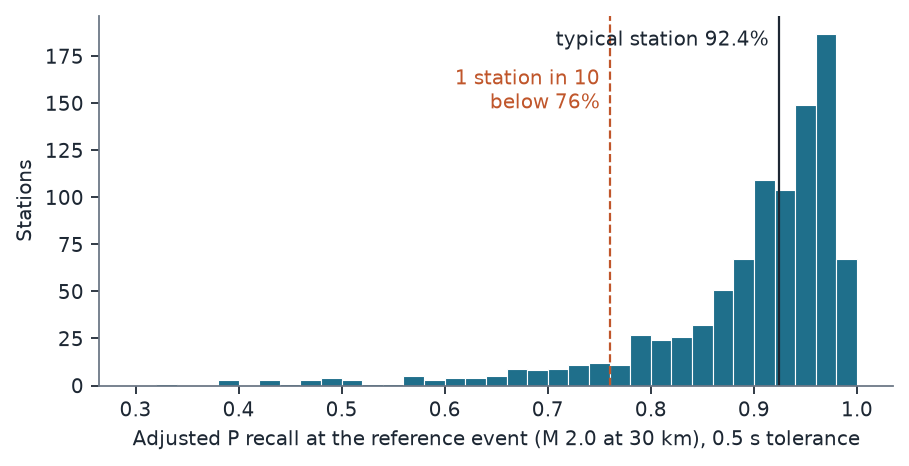
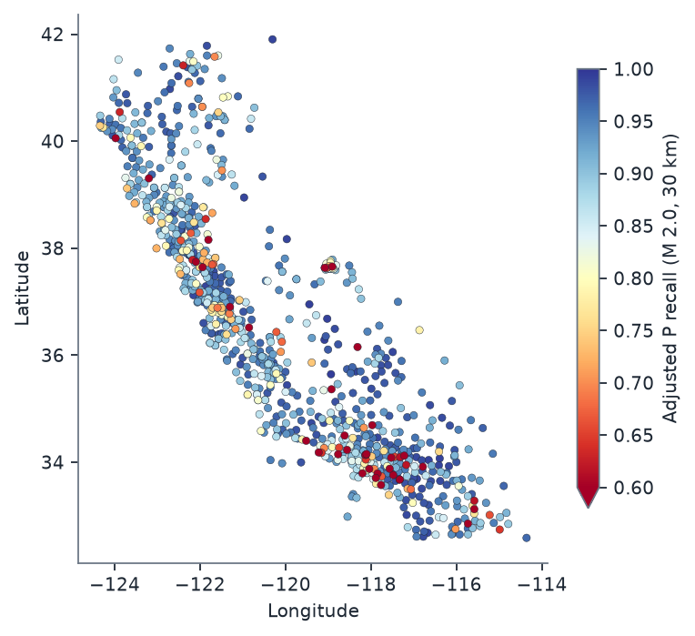
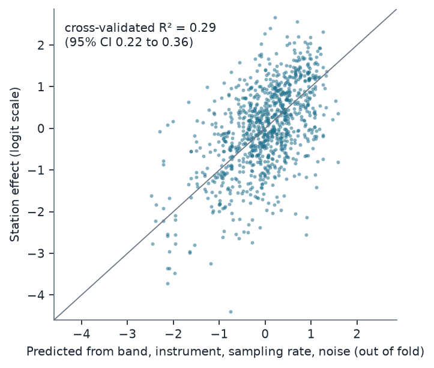

# Stations differ, but their specifications don't say which: validating QuakeScope's PhaseNet picks against analyst picks

*A preregistered station-level validation of the 2026 QuakeScope western catalogue (PhaseNet, `original` weights) against
509,596 analyst-reviewed P arrivals at 1,026 Californian stations of the CI, NC and BK networks, 2010-2024.*

Run directory: `research-lab/runs/seismology-geophysics-quakescope-analyst-validation` · Preregistration:
[`plan.md`](plan.md) (commit 5bb0f02) · Departures from it: [`deviations.md`](deviations.md) (D1-D5) · Independent
review: [`review/review.md`](review/review.md), confirmation pass:
[`review/confirmation.md`](review/confirmation.md) · 12 October 2026

**Verdict: Refuted on H2; H1 at its threshold.** The lead's hypothesis had two parts. The first (H1) was that "after
adjusting for magnitude and distance, recall varies between stations with SD ≥ 0.10". The second (H2) was that
"station attributes alone explain at least 50% of that between-station variance". The second part fails clearly, so
the joint hypothesis is refuted. The first sits on its threshold: Supported under the preregistered denominator,
Inconclusive when station-days with no catalogue output are left out. The plan set no headline rule. The tag refers to
the hypothesis, not to the catalogue, whose recall is high (first bullet).

- **The catalogue finds 91% of analyst-reviewed P arrivals within 0.5 s.** Matched picks sit a median 0.02 s after
  the analyst's.
- **Stations differ by about the amount the threshold names (H1).** After adjusting for magnitude and distance, the
  between-station SD of recall at an M 2.0 event 30 km away is:
  - **0.105** (95% CI 0.096 to 0.114) as preregistered, so H1 is Supported by the rule;
  - 0.095 (0.088 to 0.105), Inconclusive, without the 1.25% of reference picks on station-days on which QuakeScope
    produced no picks at all;
  - 0.086 on impulsive arrivals alone.

  Whether the variation clears 0.10 is not settled by these data. A typical station finds 92% of such arrivals; one
  station in ten finds fewer than 76% (79% without the zero-output days).
- **Station attributes don't predict which stations are weak (H2 Refuted).** Band code, instrument code, sampling rate
  and ambient noise explain 29% of the station-to-station variation in spatially grouped cross-validation (95% CI 22%
  to 36%), and 36% (28% to 42%) without the zero-output days. The hypothesis needed 50%.
- **Some of the weakest "stations" are processing gaps.** On 7.4% of the station-days that QuakeScope lists as read,
  it produced no picks. The worst stations in the table are largely these days. They probably come from the reader
  defect for which the catalogue is being re-read from 8 October 2026.
- **Exploratory: most confident P picks look like single-station detections.** 59% of the catalogue's P picks with
  confidence ≥ 0.5 have no analyst pick and no P pick at any of the station's 5 nearest neighbours within 10 s. They
  peak in daytime hours, like cultural noise. This is a post-hoc proxy and is labelled as such.

## In plain terms

QuakeScope is a public catalogue of 4.3 billion earthquake "picks": the moments when a machine-learning model
(PhaseNet) decided a seismic wave had reached a seismometer. Researchers are starting to build on it, but its authors
did not compare it, archive-wide, with the arrivals that human analysts picked.

We did that for California, using every P-wave arrival (the first wave) that analysts picked for local earthquakes
of magnitude 1.5 or more in 30 random months of 2010-2024. That is half a million arrivals at about a thousand stations. **The catalogue had a pick within half a second for 91% of
them, usually within a few hundredths of a second.**

We expected some stations to do much worse than others, and they do. A typical station catches 92% of the arrivals
from a magnitude-2 earthquake 30 km away; one station in ten catches fewer than 76%. Whether the spread reaches the
size we set in advance as meaningful is too close to call. It is just above it as planned, and just below it without
the days on which the catalogue produced no picks at a station, which look like a software fault now being fixed.

We also expected to predict the weak stations from what the station is: its sensor type, sampling rate and how noisy
its site is. **That failed.** Those attributes explain about a third of the differences, short of the half we set as
the bar. So anyone using QuakeScope picks at a particular station should check that station's track record, which we
release as a table.

A side finding needs confirming: most of the catalogue's confident P picks have no matching pick at any nearby
station and no analyst pick. They may be noise, or tiny earthquakes that only one station recorded.

## Related work

- **Earlier comparisons of PhaseNet with analyst picks.**
  - Münchmeyer et al. (2022) benchmark deep-learning pickers, PhaseNet among them, against analyst picks on curated
    datasets.
  - A 2025 ESS Open Archive preprint (Shimota, Tepp, Biondi and co-authors) evaluates PhaseNet against Southern
    California Seismic Network (SCSN) analyst picks for M 3+ earthquakes.
- **The QuakeScope team's own benchmarks** use curated sequences
  ([seisscoped.org/QuakeScope](https://seisscoped.org/QuakeScope/)).

None of these is an archive-wide, station-level validation of the released QuakeScope catalogue. OpenAlex lists four
works citing the QuakeScope paper, and none of them does this either.

**Reference picks that may have started as PhaseNet picks.** SCSN reported in 2024 that it "has integrated the
deep-learning picker PhaseNet into its event post-processing" (Tepp et al., SSA 2024 abstract). In that case, some reviewed SCEDC picks from
2023-2024 began as PhaseNet picks, which would favour a PhaseNet catalogue. SCEDC recall shows no such rise: 92.6% for
2010-2022 and 92.6% for 2023-2024.

## The data

**The catalogue.** The 2026 QuakeScope `western` catalogue on the anonymous S3 bucket `quakescope-picks-2026`. Its
run record names PhaseNet with the `original` weights and thresholds of 0.2.

Those weights were trained on NCEDC analyst-labelled arrivals (Zhu and Beroza 2019), so the NC and BK reference picks
from the earlier years overlap PhaseNet's training distribution, and possibly its training events. There is no sign
that this inflates recall. Recall on NCEDC picks is 89.9% in 2010-2017 and 89.4% in 2018-2024; on SCEDC picks it is
93.2% and 92.2%. Partitions:
`network={CI,NC,BK}/year=Y/month=M`, for 30 months drawn 2 per year from 2010-2024 (seed 20261011; listed in Section 3
of the plan and in `data/months.json`). The listing of every downloaded file (key, ETag, size) is frozen in
`data/manifest_picks.csv`, because the bucket is being re-read from 8 October 2026.

**The reference picks.** These are analyst-reviewed P arrivals from the two regional data centres' public phase files:

- **SCEDC** (network CI): event phase files. Local earthquakes only (type `eq`, geographic type `l`; D2).
- **NCEDC** (networks NC and BK): monthly Hypoinverse phase archives. Only events with review status F (final), joined
  from the NCEDC catalogue (D1). This excludes the automatic (A, 21%) and intermediate (I, 2%) events, among the
  NCEDC catalogue's M ≥ 1.5 events in the sampled months.

Both are "analyst-reviewed", not necessarily hand-picked from scratch. Some arrivals began as automatic picks that an
analyst accepted or adjusted.

The filters were:

- magnitude ≥ 1.5;
- epicentral distance ≤ 100 km;
- analyst weight > 0;
- one pick per event, station and phase.

Nine P picks whose arrival falls in the following, unsampled month are dropped at matching. The catalogue partitions
contain 0.6-5.7% exact duplicate rows (re-reads). They do not affect one-to-one matching, and the false-pick proxy
removes them.

**The denominator.** A reference pick counts only if QuakeScope's availability table says it read that station-day,
and the station is in QuakeScope's station list. A miss on a day QuakeScope never processed is not a picker failure.

| Step | P picks | Stations | Events |
|---|---:|---:|---:|
| Reference P picks in the 30 months | 574,133 | 1,373 | 23,316 |
| Station-day read by QuakeScope (88.8%) and station listed (99.6%) | 509,760 | 1,058 | 23,038 |
| Stations with ≥ 10 picks (the H1 model) | 509,596 | 1,026 | |
| Stations with ≥ 30 picks (H2) | | 949 | |

About 11% of the analyst-picked arrivals fall on station-days that QuakeScope never read. That is a coverage gap for
users, but outside this study's question.

The reference picks are split between the data centres: 230,292 from SCEDC (CI) and 279,468 from NCEDC (239,858 NC,
39,610 BK). The median magnitude is 1.94 (10th-90th percentile 1.57-2.75) and the median epicentral distance 50 km
(16-88 km). 56% of the picks are marked impulsive (`i`).

**Station attributes (H2).**

- **Band and instrument code:** the modal band QuakeScope read on the station's denominator days (D1 item 3).
- **Sampling rate:** from the data centres' StationXML.
- **Ambient noise:** log10 of the median 60-s RMS ground velocity, 1-10 Hz. It is taken from 09:00-10:00 UTC on 3
  random loaded days per station, from the data centres' continuous waveforms.

Of the 949 H2 stations, 25 have no usable noise value and are left missing (22 had no data or no response; 3 had a
flat, zero-amplitude trace, D3).

## Method (preregistered)

**Matching.** A reference P pick is matched if the catalogue has a P pick at the same network and station, on any
band or location code, within ±0.5 s. Matching is one-to-one, closest first. Tolerances of 0.2 s and 1.0 s are
sensitivity analyses.

**H1.** A mixed logistic model, `matched ~ M + log10(distance) + (1 | station)`, fitted by variational Bayes
(statsmodels `BinomialBayesMixedGLM`) on stations with ≥ 10 picks.

- **SD_p** is the SD of recall on the probability scale across station effects u ~ N(0, σ_u²), at an M 2.0 event
  30 km away.
- **Interval:** a station-cluster bootstrap with 200 refits.
- **Supported** if SD_p ≥ 0.10 and the lower bound ≥ 0.05. **Refuted** if the upper bound < 0.10.

**H2.** The target is each station's posterior-mean effect, for stations with ≥ 30 picks.

- **Model:** gradient boosting (`HistGradientBoostingRegressor`, defaults) on band code, instrument code, sampling rate
  and log noise.
- **Cross-validation:** 5-fold, grouped by 1° × 1° cells so that neighbouring stations are not split between training
  and test. Pooled out-of-fold R², with a 2,000-draw station bootstrap.
- **Supported** if R² ≥ 0.50 and the lower bound ≥ 0.35. **Refuted** if the upper bound < 0.50.

## Results

### Recall and timing (descriptive)

| | Value |
|---|---:|
| Pooled P recall, ±0.2 s / ±0.5 s / ±1.0 s | 86.4% / 91.0% / 92.3% |
| Pooled S recall, ±0.5 s (all 196,118 S picks in the denominator) | 88.8% |
| By data centre (P, ±0.5 s): SCEDC CI / NCEDC (NC and BK) | 92.6% / 89.7% |
| Timing of matched P picks, catalogue − analyst: median (MAD) | +0.022 s (0.022 s) |
| Matched P picks within ±0.1 s of the analyst | 85.9% |

The timing offset is similar across bands: median +0.03 s on HH, +0.02 s on EH and +0.023 s on HN channels
(`results/tables/timing_by_band.csv`). Pooled recall moves little with year (88-93%) or with distance (91.9% within
10 km, 90.8% at 60-100 km).

**Where the misses are** (post hoc, `results/tables/review/misses.json`). Of the 45,856 unmatched H1 picks:

| Nearest catalogue P pick at the station | Share of misses |
|---|---:|
| None at all: the station-day has zero catalogue picks (see the zero-output days below) | 14% |
| 0.5-1 s away (most of them late; the 1.0 s tolerance recovers these) | 15% |
| 1-3 s away | 6% |
| 3-300 s away | 22% |
| None within 300 s, on a day with catalogue picks | 43% |

The distribution of nearest-pick offsets has no peaks at whole seconds or constant offsets, so there is no time-zone,
clock or format artefact (reviewer's check, `review/review.md`).

### H1: recall varies between stations (Supported by the preregistered rule; not robust)

| | Estimate | 95% CI |
|---|---:|---:|
| SD_p at M 2.0, 30 km | **0.105** | 0.096 to 0.114 |
| σ_u (logit scale) | 1.08 | |
| Recall of a typical station (u = 0) at M 2.0, 30 km | 92.4% | |
| Fixed effects (logit scale): intercept, M, log10 distance | 2.64; 0.58 per magnitude unit; −0.88 per decade of distance | |

By the preregistered rule this is **Supported**: SD_p ≥ 0.10 and the lower bound (0.096) ≥ 0.05. The margin is thin.

- **The point estimate is only just above 0.10.** The preregistered Monte Carlo estimate (10⁵ draws) is 0.1049. The
  same integrand by quadrature gives 0.1045, and other Monte Carlo seeds give 0.1040-0.1046.
- **Many bootstrap draws fall below 0.10:** 19% of the 200 (draws range from 0.093 to 0.119).
- **The plan anticipated this.** Its power section said H1 is decidable "unless the true SD sits within about 0.01 of
  0.10", and it does sit there.
- **The result depends on a denominator choice.** Without the station-days on which QuakeScope produced no picks at
  all, SD_p is 0.095 (0.088 to 0.105) and the rule returns Inconclusive; see the zero-output days below.

The rule's interval condition (lower bound ≥ 0.05) is looser than its point condition (≥ 0.10). It asks only that the
variation be clearly non-trivial, and by that standard it is. Whether the variation clears 0.10 specifically is not
settled by these data.



**The spread is in a tail of weak stations.** Among the 949 stations with ≥ 30 picks, adjusted recall at the
reference event has:

- a median of 92.7%;
- a 10th percentile of 76% and a 5th percentile of 66%;
- 14% of stations below 80% and 35% below 90%.

Part of the lowest tail is days without catalogue output. Without them, the 10th percentile is 79%, the 5th 70%, and
11% of stations fall below 80% (see below).

**SD_p depends on the reference event.** Recall is near its ceiling, so the same logit-scale spread (σ_u = 1.08) is
smaller on the probability scale where recall is higher. Evaluated at other events (`results/tables/checks/misc.json`,
post hoc), SD_p is:

| Reference event | Typical recall | SD_p |
|---|---:|---:|
| M 2.5 at 30 km | 94% | 0.088 |
| M 2.0 at 60 km | 90% | 0.121 |
| M 1.5 at 30 km | 90% | 0.123 |
| M 1.5 at 90 km | 86% | 0.149 |

The preregistered reference event (M 2.0, 30 km) is near the middle of the data: the median magnitude is 1.94 and the
median distance 50 km.

**Secondary analyses (preregistered).**

| Analysis | SD_p | Reference picks |
|---|---:|---:|
| Tolerance ±0.2 s | 0.107 | 509,596 |
| Tolerance ±1.0 s | 0.106 | 509,596 |
| S picks (±0.5 s; stations with ≥ 10 S picks) | 0.176 | 195,079 |
| Impulsive (`i`) reference picks only | 0.086 | 284,605 |

The busiest sampled month (June 2020) holds 6.2% of the picks, below the 25% that would have triggered the
leave-one-month-out check.

The S-pick spread is larger. **On impulsive arrivals alone, H1 does not hold:** SD_p is 0.086, below 0.10. These are
the arrivals an analyst marks as clear.

**Part of the station-to-station variation is in what analysts picked at a station** (post hoc,
`results/tables/review/h1_weight_onset_covariates.json`).

- **Recall depends strongly on the analyst's weight.**
  - SCEDC: 97.7% at weight 1.0, 94.2% at 0.8, 89.0% at 0.5 and 78.2% at 0.2.
  - NCEDC: 94.3% at 1.0, 92.6% at 0.75, 86.4% at 0.5 and 69.9% at 0.25.
  - Impulsive against emergent onsets: 94.7% against 86.2%.
- **Some of the spread is pick quality.** With weight class (four classes matched across the two centres' scales, plus
  an "other" class for SCEDC's rare weight 0.3) and onset added as covariates, σ_u falls from 1.08 to 1.01.
- **H1 then falls below its threshold.** SD_p at the reference event is 0.097 for the observed mix of pick qualities.
  For top-weight impulsive picks, where typical recall is 96%, it is 0.060.
- **Distance acts through pick quality.** Its coefficient changes sign (+0.17 against −0.88). Analysts give
  distant arrivals lower weights: the mean weight is 0.92 within 10 km and 0.62 at 60-100 km, and the impulsive share
  is 88% and 38%.

The H1 estimand was preregistered without these adjustments. They show that the 0.10 threshold is crossed or not
depending on which arrivals count as the reference.



**Where the weak stations are (post hoc, descriptive).** Of the 949 stations, 95 have adjusted recall below 76% (the
10th percentile).

- **Most are short-period (EH) stations: 78 of the 95, against 476 of all 949.** CI's EH stations have a median
  adjusted recall of 79% (n = 83), against 95% for its H-band stations (n = 287: 278 HH broadband, 9 HN
  accelerometer). NC's EH stations, by
  contrast, have a median of 91% (n = 393).
- **Some areas have more than their share.** 18% of stations in the Los Angeles basin fall below 76%, as do 13% around
  Long Valley and Mammoth and 14% in the San Francisco Bay Area. That compares with 9% elsewhere.

The boxes (`review_checks.BOXES`) were drawn after looking at the map, so these shares are descriptive only:

- Los Angeles basin: 33.6-34.4° N, 117.6-118.7° W (67 stations);
- Long Valley and Mammoth: 37.4-38.0° N, 118.6-119.3° W (31);
- San Francisco Bay Area: 37.2-38.3° N, 121.6-122.8° W (106).

With a slightly different Bay Area box the reviewer obtained 17% rather than 14%.

These descriptions barely change when the station-days without catalogue output are left out (next section).

### Zero-output station-days: a review-requested sensitivity analysis (post hoc; deviations.md D5)

The preregistered denominator keeps every reference pick on a station-day that QuakeScope's availability table marks
`loaded`. That table also counts the picks QuakeScope produced that day (`npks`).

**Some loaded station-days have no output at all.**

- **How many:** 7.4% of loaded CI/NC/BK station-days in the sampled months have zero picks, and 17% have fewer than 5.
- **What they do to recall:** 6,383 of the 509,596 H1 picks (1.25%) fall on zero-pick days, where recall is 0 by
  construction. Recall rises steadily with the day's pick count: 65% on days with 1-2 picks, 82% with 3-5, 89% with
  11-20, and 95-96% above 50.
- **The largest case:** CI on 1 January 2017, an Imperial Valley swarm day (1,169 of these picks). Several stations
  near the swarm are `loaded` with zero picks while their neighbours have hundreds (reviewer's check).
- **The likely cause, in part:** on 26% of these picks the analyst's channel band was not among the bands QuakeScope
  read that day, against 3.5% on other days. That matches the reader defect the QuakeScope team describes ("the reader
  chose one channel band per station for the whole campaign, so days when that band was absent were never read"), for
  which the western catalogue is being re-read from 8 October 2026. For the rest, the tables do not show the cause.

The plan excluded never-read days because "a miss there is not a picker failure". The same reasoning applies to days
with no output.

| Denominator | Picks / stations | Pooled recall | SD_p (95% CI) | H1 under the preregistered rule |
|---|---:|---:|---:|---|
| **Preregistered: all `loaded` days** | 509,596 / 1,026 | 91.0% | **0.105** (0.096 to 0.114) | **Supported** |
| Excluding zero-pick days (200-refit bootstrap) | 503,204 / 1,025 | 92.2% | 0.095 (0.088 to 0.105) | **Inconclusive** |
| Excluding days with < 10% of the station's median count (point estimate) | 501,463 / 1,026 | 92.2% | 0.099 | (no interval) |

Without zero-pick days, SD_p is 0.095 (95% CI 0.088 to 0.105). The point estimate is below 0.10, so the rule cannot
return Supported. The upper bound is above 0.10, so it cannot return Refuted either. The rule therefore returns **Inconclusive**.

- **Bootstrap:** 14% of the 200 draws are at or above 0.10 (draws 0.083 to 0.113).
- **Why it falls:** the logit-scale spread barely moves (σ_u 1.087 against 1.078). Typical recall at
  the reference event rises from 92.4% to 93.6%, nearer the ceiling, and SD_p shrinks with it.
- **Convergence:** as in the primary fit, statsmodels' non-convergence flag is raised on the main fit and on 196 of
  the 200 refits (D4).

**The weak-station tail shrinks** without zero-pick days, though it does not disappear:

| | All loaded days | Excluding zero-pick days |
|---|---:|---:|
| 10th / 5th percentile of adjusted recall | 76% / 66% | 79% / 70% |
| Stations below 80% / 90% | 14.0% / 35.1% | 11.2% / 29.8% |

**Individual stations change most.** The worst stations in the preregistered table are largely this artefact:

- BK.BABI has 84% of its picks on zero-pick days, and raw recall 0.12 with them against 0.78 without them.
- NC.KTJ: 68% of picks, 0.28 against 0.86.
- CI.WLH2: 47% of picks, 0.53 against 0.997.

In the station table, 8 stations with more than 25% of their picks on zero-pick days are flagged, and every
station also gets its adjusted recall without those days.

**Which stations are weak barely changes.**

- **Bottom decile:** 83 of the 95 stations in the preregistered bottom decile stay in it without zero-pick days.
- **Band:** 85 of the new bottom 95 are short-period (EH) stations.
- **Regions:** the shares in the three regional boxes are the same to within one percentage point (18%, 13% and 13%,
  against 9% elsewhere).

The station effects with and without these days correlate at 0.94 (reviewer's check).

**H2 does not change.** On the station effects estimated without zero-pick days (946 stations with ≥ 30 picks), CV R²
is 0.36 (0.28 to 0.42), still Refuted. The linear model gives 0.36 and the model with secondary attributes 0.40 (0.33 to
0.46). R² rises because days without output, which no station attribute can predict, leave the target. The upper bound
is still below 0.50.

### H2: station attributes do not predict the weak stations (Refuted)

| Model (stations with ≥ 30 picks, n = 949) | CV R² | 95% CI |
|---|---:|---:|
| **Gradient boosting, four primary attributes (H2)** | **0.29** | 0.22 to 0.36 |
| Linear model, same attributes (secondary) | 0.29 | 0.22 to 0.35 |
| Gradient boosting + network, elevation, number of picks (secondary) | 0.32 | 0.25 to 0.39 |
| Reliability-corrected H2 (noise share of station effects 6%) | 0.31 | |

The upper bound (0.36) is below 0.50, so H2 is **Refuted**. The reliability correction shows that the shortfall is not
estimation noise in the station effects: those are well estimated (median 378 picks per station), and correcting for
their noise only lifts R² to 0.31.



**What the attributes do capture (post hoc, `results/tables/checks/h2_exploratory.csv` and `h2_descriptive.json`).**

| Predictors (gradient boosting, same folds) | CV R² | 95% CI |
|---|---:|---:|
| Band code alone | 0.11 | 0.07 to 0.15 |
| Log noise alone | 0.08 | 0.00 to 0.14 |
| Instrument code alone; sampling rate alone | 0.00; 0.00 | −0.01 to 0.00 (each) |
| Network alone | 0.00 | −0.02 to 0.03 |
| Location alone (latitude, longitude) | −0.13 | −0.22 to −0.05 |
| Primary attributes + location | 0.22 | 0.14 to 0.30 |
| Primary + secondary attributes + location | 0.32 | 0.25 to 0.39 |
| Primary attributes, maximum-likelihood station effects as the target | 0.29 | 0.22 to 0.36 |

Instrument code and sampling rate barely vary: 908 of the 949 stations are `H` (high-gain seismometer) instruments
and 923 sample at 100 Hz.

**Two attributes do the work: band and noise.**

- **Band.** Short-period (E band) stations average −0.39 on the logit scale, against +0.38 for broadband (H band).
- **Noise.** The noisiest third of stations average −0.54, against +0.38 for the quietest third (Spearman −0.36).
  Stations without a usable noise value average −0.67.
- **Together they interact.** The four-attribute model, whose other two attributes barely vary, reaches R² 0.29. That
  is more than band alone and noise alone added together (0.11 + 0.08), so the two interact. Even so, most of the
  variation lies within band-and-noise groups.

**Location transfers poorly between cells, but neighbours are modestly alike.**

- **Between cells.** Under the preregistered spatially grouped CV, latitude and longitude alone predict worse than the
  overall mean (R² −0.13). What a station's location says does not carry over to other 1° cells.
- **Within cells.** A station's effect correlates r = 0.32 with the mean effect of its 5 nearest stations (median
  distance 14 km); r = 0.25 for the single nearest and 0.34 for the 10 nearest.
- **Under plain 5-fold CV**, which lets neighbours sit on both sides of a split, location alone gives R² 0.10 (0.03 to
  0.16). Adding location to the four attributes raises R² from 0.33 to 0.39.

So there is local clustering at the scale of tens of kilometres, but no regional pattern at the 100-km scale that
transfers between cells (`results/tables/review/misc.json`).

The H2 result does not depend on the VB estimator. With maximum-likelihood station effects as the target, R² is also
0.29.

### Diagnostics added after the outcome (deviations.md D4; `code/checks.py`)

**VB non-convergence flag.** statsmodels raised "VB fitting did not converge" on every preregistered fit. The flag is set when
`scipy.optimize.minimize` (BFGS) reports `success = False`. Three refits with fixed starting seeds show why: each
stopped with "Desired error not necessarily achieved due to precision loss" after 700-790 iterations. The
gradient norms were 6e-5 to 4e-4, over about 2,060 parameters, and the ELBO was identical to nine significant figures.

All three reach the same optimum as the primary fit: σ_u 1.0780, and SD_p 0.10489 against the primary 0.10489. The
primary estimate is therefore reproducible despite `fit_vb`'s unseeded starting values. An L-BFGS-B refit stopped
earlier (gradient norm 36, a worse ELBO) and gives SD_p 0.1051.

**An independent maximum-likelihood fit** of the same model, by adaptive Gauss-Hermite quadrature (as in lme4's
`glmer`). `tests/aghq_test.py` checks it on synthetic data with a true station SD of 1.1
(`results/tables/review/aghq_test_output.txt`):

- **400 stations:** the realised SD is 1.060, and ML gives 1.006 (1 node) and 1.011 (15 nodes).
- **1,500 stations:** the realised SD is 1.074, and ML gives 1.067 and 1.073.

The draft's D4 entry quoted only the 1,500-station run, without saying so. In small designs both ML and VB sit a few
per cent below the realised SD (the reviewer found VB at 1.019 on the 400-station data). If anything, then, σ_u is
underestimated and the estimate is conservative for H1, though with 1,026 stations the 1,500-station run suggests the
bias is small. What the cross-check shows is that ML and VB agree with each other:

| Fit | σ_u | SD_p | Intercept, M, log10 d |
|---|---:|---:|---|
| VB (primary) | 1.078 | 0.1049 | 2.635, 0.582, −0.878 |
| ML, Laplace (1 node) | 1.065 | 0.1041 | 2.620, 0.576, −0.869 |
| ML, 15 nodes | 1.067 | 0.1044 | 2.619, 0.576, −0.869 |

Both ML fits converge to the same values from the VB estimate and from zero, with every station's conditional mode
converged at the optimum. The ML spread is about 1% smaller, as
expected for a maximum-likelihood variance component. ML also puts SD_p above 0.10, so the H1 verdict does not depend
on the estimator. The bootstrap interval was computed with VB only.

**Bookkeeping.** The station order of the VB effects matches the model's level names (1,026 of 1,026), and the
effects track raw station recall (Spearman 0.98).

### Exploratory: a false-pick proxy

The plan listed a false-pick proxy as exploratory. The proxy counts catalogue P picks with confidence ≥ 0.5 that have
no reference pick at the station and no catalogue P pick at another station within 10 s. `analysis.py` had not
implemented it, so it was added after the outcome (D4). Its caveats were added at the reviewer's request (D5).

**The proxy as preregistered is uninformative.**

- **Definitions fixed in D4:** "no reference pick" means none of either phase at the station within 1 s; "another
  station" means any CI, NC or BK station.
- **Result:** 7,485 of 9,391,601 confident P picks, or 0.013 per station-day.
- **Why it says little:** across CI, NC and BK the catalogue holds about 0.5 P picks per second (38.1 million in the
  30 months). A ±10 s window therefore almost always contains another station's pick by chance.

**A post-hoc variant: isolation from the 5 nearest stations** (`checks.py falsepick_nn`). A pick is isolated if none of
the station's 5 nearest catalogue stations (CI, NC or BK) has a P pick within 10 s. Across stations, the median of the
mean distance to those 5 neighbours is 18 km.

- **Result:** 59% of confident P picks (5.57 million of 9.39 million) are isolated and unreferenced. That is 9.4 per
  loaded station-day, against 0.86 analyst-picked M ≥ 1.5 P arrivals per station-day. Across the 949 H2 stations the
  median is 3.6 per day and the 90th percentile 23 per day.
- **The share depends on the confidence threshold.** It is 44% at confidence ≥ 0.7 and 24% at ≥ 0.9. Isolated
  unreferenced picks have median confidence 0.65 (quartiles 0.56-0.78), against 0.93 for referenced picks.
- **Picks an analyst confirmed are rarely isolated** (0.9%, against 62% of unreferenced picks). This is only a check
  that the isolation test behaves sensibly. Referenced picks come from M ≥ 1.5 events recorded at many stations, so
  they are rarely isolated by construction, and the check says nothing about what the isolated unreferenced picks
  are.
- **Neighbours were usually recording.** For 89% of isolated unreferenced picks all 5 neighbours were loaded that day,
  and for 99% at least 4 were.
- **There is a daily cycle.** Isolated unreferenced picks are 1.2-1.3 times the uniform hourly rate between 07:00 and
  13:00 local standard time (UTC−8), and about 0.8 times it between 00:00 and 04:00. Referenced picks, and unreferenced picks that are not
  isolated, show no such cycle: 57% of isolated unreferenced picks fall in the 12 hours from 07:00 to 18:59, against 48% of the others.
  That is the signature of cultural (human-made) noise, not of small earthquakes, which networks detect better at
  night. It does not measure the share.
- **Sparse networks have more isolated picks.** The isolated share is 74% at BK stations, 59% at CI and 53% at NC,
  consistent with sparser neighbours. Stations of other networks (for example BG at The Geysers, the strong-motion
  networks and the Plate Boundary Observatory) are not candidate neighbours.
- **Recall and isolated picks go together.** Stations with higher recall also have more isolated picks (Spearman
  +0.28). That is consistent with a trade-off between sensitivity and false picks at the station level.

**What "unreferenced" means.** "No analyst pick for an M ≥ 1.5 event within 100 km", not "no earthquake". Events below
M 1.5 are the great majority of catalogued events, and the reference never contains them.

**What the isolated picks could be.**

- **Noise detections.** The daily cycle points this way.
- **Tiny earthquakes recorded at one station only.** Their number is unknown.
- **Picks whose neighbours lacked data.** These are rare, as above.

The proxy is a flag, not a precision estimate. It says the catalogue's P picks at confidence ≥ 0.5 are not, by
themselves, a list of earthquake arrivals. A precision study would need event association or template matching.

## What this means

**For users of the catalogue.** At these networks QuakeScope's `original`-weight PhaseNet picks find nine in ten
analyst-reviewed P arrivals of local M ≥ 1.5 events, with near-analyst timing. That is a usable catalogue. But recall
is not uniform. About one station in eight sits below 80% at a typical event (11-14%, depending on whether days
without output count), and the station's specifications do not identify it. Studies that depend on complete phase coverage at particular stations should check those stations
directly. The released table `results/tables/station_reliability.csv` gives every station's adjusted recall, with an
interval and the attributes used here.

**For the QuakeScope team.**

- **Weak stations are mostly station-specific.** Short-period sensors and noisy sites do worse, and neighbouring
  stations are modestly alike. But most of the variation is not explained by attributes or location. That argues for
  per-station evaluation of the staged `quakescope2026` weights, and perhaps site-aware calibration.
- **Check the station-days that are `loaded` with no picks.** 7.4% of the loaded station-days in the sampled months
  have `npks = 0`. On 26% of the reference picks on those days, the analyst's channel band was not among those
  QuakeScope read, against 3.5% on other days. That fits the reader defect behind the re-read. The station table flags
  the 8 stations with more than 25% of their reference picks on such days, and it can serve as a check after the
  re-read.
- **False picks may be the larger gap.** On the post-hoc proxy, most confident P picks lack any corroborating pick
  nearby. A precision study is a natural next lead.

**What this does not show.**

- **Not precision.** Recall against analyst picks says nothing about false picks. The proxy is crude and post hoc.
- **Not other regions.** Not other networks (UW, NN, UU and others in the western catalogue), not the 2025 archive
  (run with `instance` weights, according to the QuakeScope site), and not small events (M < 1.5).
- **Not a true miss rate.** Reference picks are the data centres' reviewed picks. Some started as automatic picks, and
  analysts pick some arrivals that a picker cannot be expected to see.

## Limitations

- **Analyst picks are a reference, not ground truth.** Emergent arrivals have real timing uncertainty; the impulsive
  subset is the cleaner comparison (SD_p 0.086).
- **H1 sits on its threshold.** The rule returns Supported under the preregistered denominator and Inconclusive
  without zero-output days. 19% of the primary bootstrap draws are below 0.10, and the impulsive and pick-quality
  analyses put SD_p at 0.086-0.097. The H1 result is best read as "about 0.10".
- **The model assumes station effects are normal on the logit scale.** The observed distribution has a long low tail
  (skew −0.49; Figure 1).
  - The empirical SD of posterior-mean station recall across the 949 stations is 0.115, above the model's 0.105. The
    logit-normal summary is therefore conservative for the H1 threshold.
  - But the excess comes from the tail, which is partly zero-output days. Without those days the empirical SD is
    0.103 (946 stations), and for stations with ≥ 100 picks it is 0.098.
- **The noise covariate is noisy.**
  - It contains physically implausible values. 33 stations exceed log10 RMS −6 (1 µm/s in 1-10 Hz at night) and 32
    fall below −8.7, under the low-noise model. These are response, metadata or dead-channel problems, so part of
    the noise-recall association is "broken station" detection.
  - Of the 927 stations with any noise windows, 495 have fewer than the full 180 one-minute windows, and 14 have fewer
    than 60. The window count is now in the station table.
  - The plan's FDSN dataselect fallback for stations without S3 waveforms was not implemented: 21 stations have no
    noise value for that reason.
- **The noise covariate is a 3-hour sample** (three one-hour windows at night local time). It may misrepresent
  stations whose noise is daytime or seasonal (urban, coastal).
- **Coverage.** Only CI, NC and BK, and only 30 sampled months. 11% of analyst-picked arrivals fall on station-days
  QuakeScope did not read, and are excluded.
- **Variational Bayes.** Every preregistered fit carries statsmodels' non-convergence flag (as do all but 4 of the
  201 fits without zero-output days). The diagnostics above show that the flag
  reflects BFGS's precision-loss stop at a near-zero gradient, and that maximum likelihood agrees.

## Deviations

- **D1** (before matching): implementation details. NCEDC status F only; a 1 km distance floor; the band covariate
  taken over denominator days rather than matched days; the noise-hour method; the bootstrap labels.
- **D2** (before matching): SCEDC header variants; local events only.
- **D3** (after a crash, before any outcome was seen): three flat-trace stations' log noise of −∞ set to missing; H1
  saved before H2; 13 bootstrap workers; a smoke test of the whole pipeline.
- **D4** (after the outcome): the diagnostics and the exploratory false-pick work above, plus figures. No verdict
  changed.
- **D5** (after the outcome, at the reviewer's request): the zero-output-day sensitivity analysis (H1 Inconclusive
  without those days), the weight and onset covariates, the AGHQ test correction, the false-pick caveats, the
  location analyses and the new station-table columns. The preregistered verdicts are unchanged and stay primary.

## Reproduce

```
venv/bin/python code/fetch.py months && venv/bin/python code/fetch.py catalogues
code/run_fetch.sh            # catalogue partitions, availability, stations, phase files, StationXML (about 2.4 GB)
venv/bin/python code/parse.py && venv/bin/python code/covariates.py 12 && venv/bin/python code/match.py
venv/bin/python code/analysis.py            # H1 (about 4 h with 13 workers), H2, secondary
code/run_checks.sh && code/run_aghq.sh      # D4 diagnostics
code/run_review_checks.sh                   # D5 review-requested analyses (zero-output days: about 3.5 h)
venv/bin/python code/checks.py falsepick_nn
OMP_NUM_THREADS=2 venv/bin/python code/figures.py
```

Tests: `tests/synthetic_test.py` (recovery of a known station SD and covariate structure), `tests/smoke_main.py`
(the whole `main()` on synthetic data), `tests/aghq_test.py` (the ML cross-check).

## Data and citations

- **QuakeScope:** Ni, Y., Denolle, M. A., Thomas, A. M., Hamilton, A., Münchmeyer, J. et al. (2025). QuakeScope.
  *Seismica* 4(2), doi:10.26443/seismica.v4i2.1738. Picks CC0, from `s3://quakescope-picks-2026` (`western`).
- **SCEDC (2013):** Southern California Earthquake Data Center, Caltech, doi:10.7909/C3WD3xH1. Event phase files
  and continuous waveforms from the public AWS bucket.
- **NCEDC (2014):** Northern California Earthquake Data Center, UC Berkeley Seismological Laboratory,
  doi:10.7932/NCEDC. Phase archives, catalogue and continuous waveforms from the public AWS bucket.
- **PhaseNet:** Zhu, W. and Beroza, G. C. (2019). *Geophys. J. Int.* 216, 261-273.
- **Released tables** (derived): `results/tables/station_reliability.csv`, `primary.json`, `secondary.csv`,
  `timing_by_band.csv`, `h1_bootstrap_draws.csv`, `results/tables/checks/` and `results/tables/review/`.
