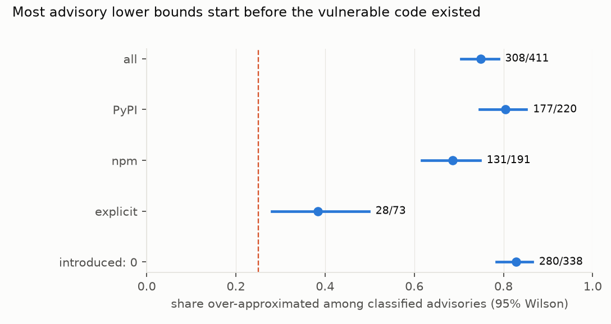
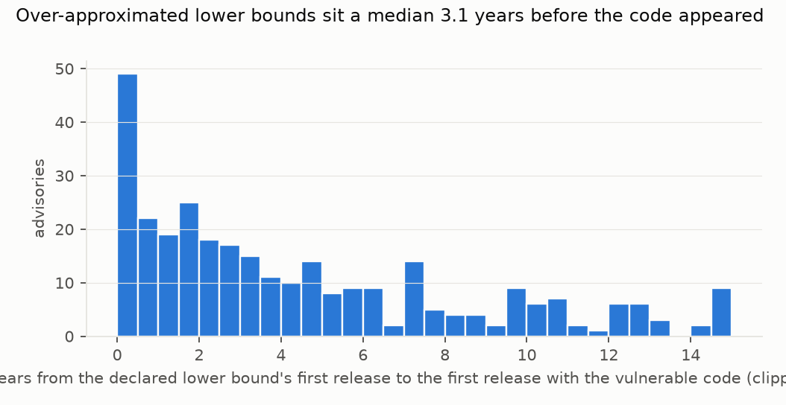

# Do npm and PyPI security advisories declare affected ranges that start too early? A code-presence test says three in four do, but a blind audit shows the test over-calls it; the defensible share is a quarter to a half

*800 GitHub-reviewed npm and PyPI advisories with a fix commit (a seeded random sample of the 6,409 eligible) were
checked release by release. The test asked whether the code the fix removes or guards existed in each release inside
the declared affected range, from the earliest onward. A separate session then re-judged 60 of them from the code
alone. The plan was committed before any advisory, commit or package file was downloaded.*

**Verdict: H1 Inconclusive; H2 Inconclusive.** The pipeline's counts would give Supported for both. The
preregistered audit found that the pipeline's "over-approximated" label is right only a third of the time, so by the
plan's rule its share is reported as unreliable.

- **H1 (at least 25% of advisories declare a lower bound that starts before the vulnerable code existed):
  Inconclusive.**
  - **Pipeline:** 308 of the 411 classified advisories are over-approximated (75%; Wilson 70.5% to 78.9%), and 103
    are tight. Even counting every undetermined advisory as not over-approximated, that is 38.5% of all 800.
  - **The audit:** a separate session judged 30 pipeline over-approximations and 30 tight cases from the fix diff and
    two releases, without the labels.
    - Of the 30 over-approximations, it confirmed 10 (33%), contradicted 8 and could not decide 12. The plan
      requires 80%.
    - Of the 30 tight cases, it confirmed 24.
    - The contradicted cases are the same flaw in code written differently in the earlier release:
      renamed, rewritten or moved.
      Exact line signatures miss it, and the pipeline calls it absent.
  - **Audit-calibrated range:** applying the audited fractions to all 308 gives 25% to 55% of classified
    advisories. The bar of 25% is the bottom of that range.
  - **Strict reading** (post hoc): the module the fix touches is missing altogether from the earliest in-range
    release (no file of the same name). That holds for 142 of the 308, or 58% (52% to 64%) of strict plus tight.
    The auditor contradicted none of the 14 audited strict cases, but could decide only 4 of them.
  - 49% of the sample is undetermined: no usable signature (79), no diff (10), or no release in which the signature
    matches (300). That is above the plan's 40% warning line, so any share rests on a minority of the sample.
- **H2 (correcting the lower bounds removes at least a third of affected version pairs, a factor of 1.5):
  Inconclusive.**
  - **Pipeline:** 35,590 declared (version, advisory) pairs fall to 16,353, a factor of **2.18** (1.93 to 2.50).
  - **Strict reading:** the factor is **1.35** (1.27 to 1.45), below the bar. The pipeline figure rests on the
    classification the audit found unreliable.
  - **npm installs** (pipeline classes): 36% of current weekly downloads of versions inside declared ranges fall
    outside the corrected ranges.
- **What holds regardless of the audit.**
  - **"Introduced: 0" ranges drive the pattern.** 81% of sampled advisories declare every release affected. Of
    those classified, the pipeline flags 83% (280 of 338), against 38% (28 of 73) of explicit lower bounds.
  - Where a lower bound starts too early, the gap is long: a median of 42 releases, or 3.1 years (pipeline classes).
  - **Upper bounds:** in 35 of 693 checked advisories (5%), the vulnerable code is still present in the first
    release at or after the declared fixed version. "Present" calls are the reliable direction in the audit.

## In plain terms

When a security flaw is found in an open-source package, an advisory records which versions are affected. Tools such
as Dependabot then warn everyone who uses those versions. If the advisory says "every version before the fix" when the
flaw only arrived recently, users of old, safe versions get warnings they do not need.

We took 800 advisories for JavaScript (npm) and Python (PyPI) packages and checked, release by release, whether the
code that the fix changed was actually there. A simple automatic check said three in four advisories start their
range too early. But when a separate reviewer looked at a sample by hand, the automatic check's "too early" could be
confirmed only a third of the time; in a quarter of cases the flaw was already there. Code that existed in an older form, renamed or moved, fooled it.

So the true share is roughly a quarter to a half of the advisories we could check. The clearest pattern is
the default: four in five advisories say every version is affected, and those are the ones most often too broad. A
better check, one that recognises older forms of the same code, is needed before the extra warnings can be counted.

## What was asked

The lead (`software-security-advisory-range-overapproximation`) asked whether published advisory ranges for npm and
PyPI over-approximate the affected versions, and how many dependency alerts that inflates. It predicted at least 25%
over-approximated lower bounds and a 1.5-fold inflation.
- **Affected-version identification has been studied as a tool problem** for C/C++ (no tool above 45% accuracy; Chen
  et al. 2025) and Java (VERJava, Sun et al. 2022).
- **An OSV-derived dataset for evaluating detection tools takes the published ranges as ground truth** (Mandl et al.
  2026).
- No measurement of the published npm and PyPI ranges against code presence was found.

## How it was done

- **Advisories** (`code/eligible.py`): the OSV export for npm and PyPI (2026-11-07). GHSA records, not withdrawn, one
  affected package, a range with `introduced` and `fixed` events (OSV encodes npm ranges as SEMVER; D1), and a fix
  commit. 6,409 are eligible; 400 npm and 400 PyPI were sampled.
- **Fix diffs** from github.com (790 of 800; D2) and **release lists** with publish dates from the npm registry and
  PyPI.
- **Signatures** (`code/presence.py`, unit-tested): the normalised lines the fix deletes in non-test source files.
  For fixes that only add a check, the signature is the context lines before the added code, and the added lines are
  a patch signature.
- **Presence:** the share of signature lines found in the matching file of a release. "Present" needs at least 80%,
  "absent" at most 20%, and anything between is undetermined.
- **Classification:** releases inside the declared range are walked in publish order, stopping at the first present
  one.
  - **Tight:** the earliest in-range release is present.
  - **Over-approximated:** an absent release comes before the first present one.
  - **Undetermined:** otherwise.
  - A cap of 400 downloads per advisory was reached by 41 advisories (D2).
- **G4 audit** (`code/audit_packets.py`): a stratified sample of 30 over-approximated and 30 tight advisories. Each
  packet holds the fix diff and the matching source files of two in-range releases (A, the earliest; B, the first
  present or a mid-range release). A separate session labelled each release present, absent or cannot tell; the
  pipeline's labels stayed outside its view.

## Results (`results/figures/F1_share.png`, `F2_gap.png`)

| reading | over-approximated | classified | share (95%) | H2 factor (95%) |
|---|---|---|---|---|
| pipeline (preregistered) | 308 | 411 | 75% (70.5–78.9) | 2.18 (1.93–2.50) |
| pipeline, thresholds 0.6 / 0.4 | 360 | 487 | 74% (69.9–77.6) | |
| strict: module missing in release A (post hoc) | 142 | 245 | 58% (51.7–64.0) | 1.35 (1.27–1.45) |
| audit-calibrated range (post hoc) | | 411 | 25%–55% | |

| G4 audit | auditor: absent in A | auditor: present in A | auditor: cannot tell |
|---|---|---|---|
| pipeline over-approximated (30) | 10 | 8 | 12 |
| pipeline tight (30) | 1 | 24 | 5 |

By ecosystem (pipeline): PyPI 177 of 220 (80%), npm 131 of 191 (69%).

## What this does and does not show

- **Line-signature patch presence is not reliable for "absent".** It recognises present code well (24 of 30 tight
  cases confirmed). But it calls code absent when the same flaw existed in another form, and that is exactly the
  judgement over-approximation turns on. Measuring range accuracy at scale needs a matcher that follows code through
  renames and moves.
- **"Introduced: 0" is the weak spot.** Whatever the exact share, the default "all earlier versions" range is flagged
  far more often than an explicit lower bound.
- **The alert inflation is not established.** Under the strict reading it is well below the pipeline figure (1.35
  against 2.18) and below the bar.
- **Not shown:**
  - **Exploitability.** Presence of the code is not proof that a release was exploitable, and absence was hard to
    establish.
  - **Dependency-graph alert counts** (deps.dev). Version pairs and npm downloads stand in for them.
  - **Advisories without a fix commit**, which are 2,850 of the 9,259 GHSA records with a range in these ecosystems.

## Process and deviations

- **Preregistration:** `plan.md`, committed before any data. Eligibility and the sample, then the fetch, presence and
  classification code, were committed before any presence result.
- **Deviations** (`deviations.md`): D1, the SEMVER range type (before any commit or release was fetched); D2, public
  diff URLs, the release walk and the cap; D3, after the G4 audit, the strict reading and the audit-calibrated range
  (post hoc).
- **Quality gates:** G1 (plan section 5), G2 (`results/tables/coverage.json`), G3 (`results/plausibility.md`), G4
  (`results/tables/g4_audit.json`; failed its bar, reported as such), G5 (`review/overclaim_check.md`) and G6
  (`results/attribution_ledger.csv`).
- **Independent review:** queued (Fable), per the lab's pacing rule.

## Reproducing it

1. `code/eligible.py` (OSV export in `data/raw/`).
2. `code/fetch.py versions`, then `code/fetch.py commits`.
3. `code/presence.py run`.
4. `code/classify.py run`, `code/classify.py downloads`, `code/classify.py run`.
5. `code/audit_packets.py make` (key outside the run directory), labelling in a separate session, `code/audit_packets.py score`.
6. `code/posthoc_strict.py`, `code/figures.py`.
