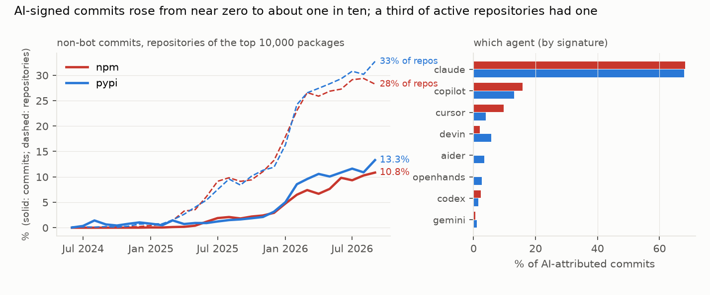
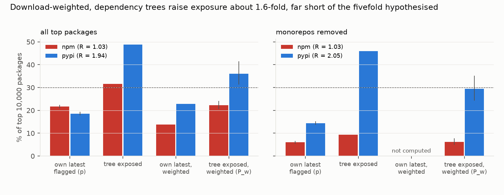

# AI coding agents in the npm and PyPI supply chain: a fifth to a third of new releases now carry agent-signed commits, but dependency trees do not multiply the exposure, and agent commits ship no faster

*The top 10,000 npm and the top 10,000 PyPI packages by downloads were traced to 13,134 GitHub repositories, 10,372
of them with commits since 2024 (5.3 million commits). Every commit was checked for an AI-agent signature, and every
release since June 2024 (423,181) was mapped to its commit range. Resolved dependency graphs come from deps.dev. The
plan and all code were committed before any data was downloaded.*

**Verdict: H1 Refuted; H2 Refuted.**

- **H1 (download-weighted dependency exposure is at least 5× the share of packages that are themselves AI-flagged,
  and over 30% for npm): Refuted on both parts.**
  - **npm.**
    - 21.6% of top packages' latest releases contain an agent-signed commit (p).
    - The download-weighted probability that a top package's resolved tree contains such a release (P_w) is
      22.3% (20.6–24.1%).
    - R = P_w / p = 1.03 (0.95–1.11).
  - **PyPI.** p = 18.6%, P_w = 35.5% (30.7–40.9%), R = 1.91 (1.65–2.21).
  - **Weighting lowers npm exposure.** Unweighted, 32% of top npm and 48% of top PyPI packages have at least one
    flagged release in their tree. The most-downloaded npm packages are small utilities with small, rarely released
    trees.
- **The caveat is monorepos, and it lowers npm sharply.**
  - When one repository hosts many packages, a commit to any of them flags every sibling's release.
  - Without such packages, npm p is 6.0% and P_w 6.1%; PyPI p is 14.4% and P_w 28.7%. R barely moves (1.03 and
    2.00).
  - Tag-only ranges give npm 14.3% / 14.9% and PyPI 11.7% / 24.7%.
- **H2 (agent commits reach a release at most half as fast as matched human commits): Refuted.**
  - The median commit-to-release latency is 6.8 days for agent commits against 6.7 for human commits matched in the
    same package within 14 days (296,806 pairs, 2,528 repositories).
  - The ratio is 1.01 (0.99–1.11).
- **The trend is steep.**
  - Agent-signed commits were 0.1% of non-bot commits in npm repositories in March 2025 and 10.8% in September 2026;
    in PyPI repositories, 1.4% and 13.3%.
  - The share of new releases containing at least one such commit rose from under 1% in January 2025 to 37% (npm)
    and 33% (PyPI) in September 2026. Without monorepo packages, whose releases inherit sibling commits, the
    September 2026 shares are 21% and 25% (`results/tables/monthly_no_monorepos.json`).
  - Claude Code signs 68% of attributed commits, Copilot 13–16% and Cursor 4–10%.
- **The detector is precise.** All 100 randomly audited matches are genuine agent signatures (95% lower bound
  96%). It is blind to unsigned use, so every share is a lower bound.

## In plain terms

Most software is assembled from thousands of free packages that other people maintain. AI coding agents, tools that
write and commit code on a developer's behalf, have spread fast. Many leave a signature in the project history, such
as a "Co-authored-by: Claude" line.

We looked at the 20,000 most-downloaded packages for JavaScript (npm) and Python (PyPI) and read every change made since 2024 to the nine in ten we could trace to a repository. In September 2026, about one in ten changes carried an AI agent's signature, up from almost none two
years earlier. Between a fifth and a third of new versions included at least one such change, depending on how packages that share a repository are counted. These are minimum figures, because
unsigned AI help leaves no trace.

We expected that because packages depend on other packages, the reach would multiply: install one popular package
and you pull in dozens of others, so a few AI-touched packages could end up in most installations. That
multiplication was modest. For JavaScript it was essentially none once popularity is taken into account; for Python
it was about double. We also checked whether AI-written changes are rushed out faster than human ones. They are not:
both take about a week to reach a release.

Nothing here says AI-written code is less safe. The study measures where it goes, not how good it is.

## What was asked

The lead (`software-security-ai-code-supply-chain-exposure`) asked how far agent-attributed commits reach registry
releases, and through dependency trees, installations.

Prior work studies agent pull requests on GitHub:
- AIDev (Li, Zhang & Hassan, MSR 2026; arXiv 2602.09185), with 932,791 agent pull requests;
- fingerprinting of agents (Ghaleb 2026, arXiv 2601.17406);
- adoption (Robbes et al., TOSEM 2026; arXiv 2601.18341);
- follow-up fixes on agent pull requests (Takerngsaksiri et al. 2026, arXiv 2609.26847);
- the closest work, a validated census of agent traces across 180 million repositories (Khosravani & Mockus 2026,
  arXiv 2606.24429), which measures prevalence in repositories, not in releases or dependency trees.

None was found that maps agent commits to published releases or weights them by dependency trees and downloads.

## How it was done

- **Packages.** The top 10,000 per ecosystem by last-month downloads (ecosyste.ms, fetched 2026-10-24), with
  registry metadata: release publish times, pre-releases excluded.
- **Repositories.**
  - GitHub repositories were resolved for 9,810 npm and 9,026 PyPI packages: 13,134 repositories.
  - They were cloned bare, treeless and shallow since 2024-01-01.
  - 10,372 were cloned. 2,626 had no commits since then and count as cloned with unflagged releases (D1). 135 were
    gone or private, and 1 failed.
- **Attribution** follows a fixed rule list (`code/attribution.py`, committed before any clone): co-author trailers,
  "Generated with" lines and agent accounts for 11 agents. Dependency and maintenance bots are excluded.
- **Releases.**
  - Each release since 2024-06-01 is matched to a git tag (283,022 by tag range, 5,344 by tag and date), or else to
    a date window on the default branch (134,584).
  - A release is flagged if its commit range contains an agent-signed commit.
- **Exposure.**
  - deps.dev resolved graphs exist for 9,663 npm and 9,649 PyPI latest versions.
  - A root is exposed if any node, itself included, is a flagged release. Flags exist only for packages in the study
    set, which covers 97.7% (npm) and 99.4% (PyPI) of non-root nodes.
  - P_w weights roots by downloads. Intervals come from 2,000 package bootstrap resamples.
- **Latency.**
  - Each agent commit in a tag-based range is matched to the nearest-in-time human commit in the same package
    (±14 days, without replacement).
  - The ratio of medians has a bootstrap interval over repositories.

## Results

### The trend and the agents (`results/figures/F1_monthly_agents.png`)

### Exposure (`results/figures/F2_exposure.png`)

| | npm | PyPI |
|---|---|---|
| packages with a repository (cloned or inactive) | 9,757 | 8,934 |
| p: own latest release flagged | 21.6% (20.8–22.4) | 18.6% (17.8–19.4) |
| tree exposed, unweighted | 31.6% | 48.4% |
| P_w: tree exposed, download-weighted | 22.3% (20.6–24.1) | 35.5% (30.7–40.9) |
| R = P_w / p | 1.03 (0.95–1.11) | 1.91 (1.65–2.21) |
| R, monorepos removed | 1.03 (0.82–1.27) | 2.00 (1.65–2.39) |
| R, tag-based ranges only | 1.05 (0.95–1.15) | 2.12 (1.77–2.51) |

**Most widely included flagged releases** (package names only):
- PyPI: `cryptography` and `cffi` are in the resolved trees of 902 and 1,052 top PyPI packages.
- npm: Babel's `@babel/code-frame` and `@babel/helper-validator-identifier` are in the trees of 285 and 375 top npm
  packages, and `react-is` in 101.

The npm cases come from monorepos, where attribution to a particular package is loose.

### Latency (H2)

| | pairs | median agent commit → release | median matched human commit → release |
|---|---|---|---|
| npm | 199,570 | 5.4 days | 5.3 days |
| PyPI | 97,236 | 13.1 days | 12.2 days |
| both | 296,806 | 6.8 days | 6.7 days |

65,399 agent commits had no human commit in the same package within 14 days and are not in the comparison.

## What this does and does not show

- **Agent-signed code is now routine in the most-downloaded packages.** About a third of new releases in late 2026
  contain at least one agent-signed commit, and the share of signed commits has risen six- to eightfold in a year.
- **Dependency trees do not amplify it much.**
  - In npm, download-weighted exposure equals the packages' own rate: heavily downloaded packages are small, and
    their trees rarely include recently released, agent-touched versions.
  - In PyPI, trees double the rate, largely through a few hubs (`cryptography`, `cffi`).
- **Agent commits are not fast-tracked.** They wait as long as human commits for a release.
- **Not shown:**
  - **Quality or security.** Provenance is not risk.
  - **Unsigned AI use,** so every share is a lower bound.
  - **Monorepo precision.** Monorepo release ranges over-attribute, as the 22% vs 6% npm contrast shows.
  - **Exact reach to installs.** The resolved graphs are deps.dev's resolution of the latest version, not real
    lockfiles, and downloads include CI and mirrors.

## Process and deviations

- **Preregistration:** `plan.md`, with `code/attribution.py` and all pipeline code committed before data.
- **Deviations** (`deviations.md`): D1, before any flag. Repositories with no commits since 2024 count as cloned
  and unflagged rather than excluded, because excluding them would inflate p.
- **Precision audit:** `results/tables/precision_audit.json`, 100 of 100 genuine.
- **Independent review:** queued (Fable), per the lab's pacing rule.

## Reproducing it

1. `code/fetch.py top`, then `code/fetch.py registry`.
2. `code/clone.sh` (repository list), then `code/classify_failures.sh`.
3. `code/extract.py run`.
4. `code/deps.py`.
5. `code/analyse.py`.
6. `code/figures.py`.
