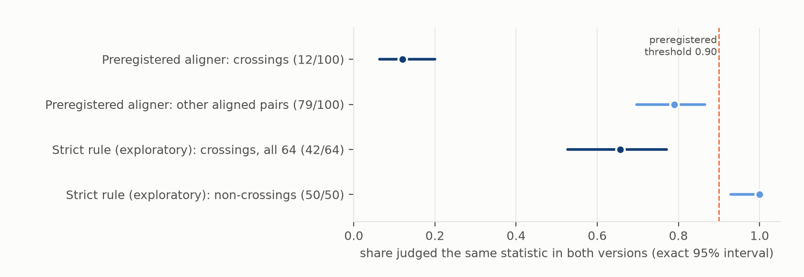
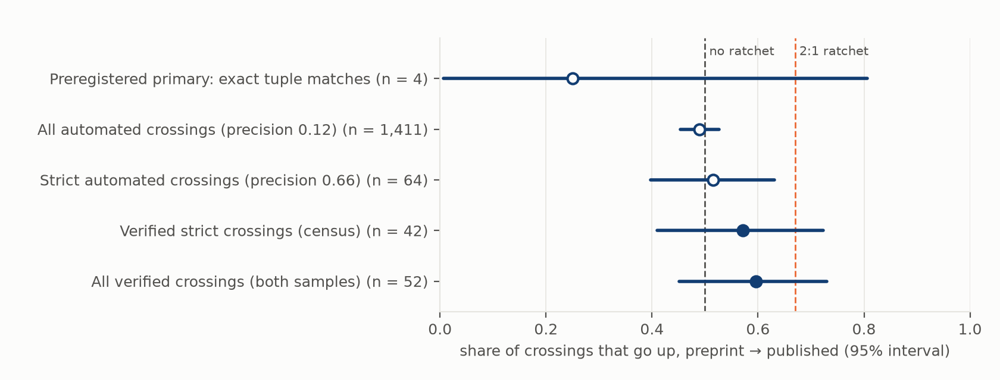

# Does peer review push p-values across 0.05 in one direction?

*Version-matched statistics in 23,220 preprints and their published journal versions: when a reported p-value crosses
0.05 between the two, does it more often move into significance than out of it?*

**Verdict: Inconclusive.** The preregistered test could not be run as planned.

**Why.** Automated matching of statistics between versions mostly finds artefacts. In a blind check, 88 of 100
automatically detected crossings were not the same statistic in both versions, or were misread. That tripped the
preregistered abort rule, which leaves exact test-statistic matches, and there are only **4** of those (1 up). Four
crossings cannot test anything.

**What hand verification shows.** A stricter, exploratory matching rule was specified after the abort and every
crossing it found was checked by hand. Of the **52** crossings verified across both checks, **31 go up**
(non-significant in the preprint, significant when published): 0.60, 95% interval 0.45–0.73. That leans up, but it
is consistent with no ratchet (0.50) and with the 2:1 ratchet the lead predicted (0.67).

**Three things are clearer than the headline:**

- **Crossings are rare.** In the strict set, about 2.8 automated crossings per 1,000 statistic pairs, of which two
  thirds were real: under 2 per 1,000.
- **No selective dropping.** Statistics removed from preprints were significant as often as statistics added in the
  published version (81.5% vs 82.0%; difference +0.5 points, 95% interval −1.7 to +2.6).
- **Inconsistencies persist.** Of 187 preprint statistics whose p-value does not match its own test statistic, 19
  (10%) were consistent in the published version. The lead predicted fewer than half.

## In plain terms

When scientists post a preprint and later publish the paper in a journal, some numbers change. If peer review or
revision tends to nudge results over the line into "statistically significant" (p below 0.05), we would expect more
results to cross into significance than out of it. We tried to measure that across more than 23,000 papers, mostly
COVID-era medicine and biology, by finding each p-value in both versions and checking whether its significance
changed.

The computer matching did not work well enough. When we checked 100 of the changes it found, 88 were mistakes. Some
were garbled characters ("1.0Ã10â5" instead of 1.0×10⁻⁵), some were decimal commas or middle dots, and many matched
the wrong number in a table or a list. Changes in significance are rare, so mistakes dominate them. Our planned test
therefore had only 4 trustworthy cases.

We then checked every candidate under a stricter rule by hand. Of 52 genuine changes, 31 moved into significance and
21 out of it. That tilt could be chance: the data fit both "no push" and "a strong push". Two side results are firmer.
Results that disappeared between versions were not less significant than results that appeared, so there is no sign
of non-significant results being quietly dropped. And internal arithmetic errors in preprints were rarely fixed in
the journal version.

The main lesson is about method. Anyone automating this kind of comparison needs to repair text encoding, handle
tables separately and check by hand. Otherwise the "changes" they count will mostly be their own errors.

## What was asked

The lead (`trust-preprint-significance-ratchet`) proposed that among reported statistics present in both a preprint
and its published version, those whose significance at 0.05 changes would cross upward at least two times in three
(H1: share up ≥ 0.67 with the lower end of a paper-level bootstrap interval above 0.50; Refuted if the upper end is
below 0.67). Three secondaries were preregistered:

- S1: dropped vs added statistics;
- S2: statcheck-style consistency and its repair;
- S3: exact tuple matches, and a split by server.

## What was already known

Version comparisons so far work at the level of primary outcomes or claims:

- In medRxiv prevention preprints, 16.8% changed primary-outcome magnitude (Sci Rep 2023).
- About 10% of bioRxiv epidemiology preprints changed main findings (Bero et al. 2021).
- Primary end points were concordant in 98% of medRxiv–journal pairs (JAMA Netw Open 2022).
- An LLM classification of 72,644 bioRxiv pairs found more cautious wording and rare changes of claim (bioRxiv
  2026.06.30.735556).
- statcheck work shows that journal adoption reduces decision inconsistencies near 0.05 (Nuijten & Wicherts 2024).

A search on 2026-10-17 found no version-matched study of the direction of significance crossings across all reported
statistics.

## How it was done

**Pairs.** The preprints are the 75,217 full texts in Europe PMC's preprint shards (bioRxiv, medRxiv, Research
Square, Preprints.org and others). Server-asserted publication links (Crossref relations, the bioRxiv API) were
confirmed by title similarity (token Jaccard ≥ 0.5), giving 28,597 pairs. The 23,220 with an open-access published
version in PMC were fetched. The primary population is the **11,508** pairs whose preprint full text is known to be
version 1, so it predates peer review. Of all pairs, 13,049 had statistics in the sections used.

**Extraction.** p-values and statcheck-style tuples (t, F, r, χ², z with df) were taken from abstracts, results,
tables and figure captions. Boilerplate threshold sentences were removed. Significance is determined only when the
comparator makes it unambiguous (for example p = 0.03, p < 0.01, p > 0.1); everything else, including p = 0.05, is
undetermined. That gave 271,195 statistics.

**Alignment.** Exact tuple matches came first, then one-to-one matching of sentences by TF-IDF with numbers masked
(cosine ≥ 0.6, same section group), with several statistics in a sentence paired by order. 110,143 statistics were
aligned.

**Blind validation and abort rule (plan §6).** Before any crossing was tallied, 100 crossings and 100 other aligned
pairs were drawn and shown in random order with the version order and stratum hidden. The adjudicator, who was the
agent running the study, judged whether each pair reported the same statistic. The plan required precision among
crossings of at least 0.90 for the all-crossings test; below that, the primary falls back to exact tuple matches only.

**Exploratory v2 (deviations D3, D4), specified in writing before it was built.**

- Extraction repairs: text repair with ftfy for mojibake, middle-dot and comma decimals, partial eta squared no longer
  read as p, lost exponents treated as undetermined.
- A **strict crossing** must satisfy all of the following:
  - it sits in abstract or results text (no tables, no legends);
  - it is an exact tuple match or has a masked sentence cosine of at least 0.80;
  - its sentence holds the same number of statistics as its counterpart, and the pair has the same rank in each;
  - neither sentence is a significance-star definition.
- A fresh blind validation, with the aligned statistic marked in each sentence.

## Results

### The preregistered primary: 4 crossings, Inconclusive

The blind validation found **12 of 100** crossings correct (precision 0.12), against 79 of 100 for aligned pairs that
did not cross (Figure 1). The abort rule applied. Among exact tuple matches in the version-1 population there are
**4 crossings, 1 up** (0.25).

The plan's rule, applied mechanically to the paper bootstrap interval [0.00, 0.50], returns Refuted. A percentile
bootstrap over four observations is not a 95% interval, though. The exact interval for 1 of 4 is **0.006–0.81**,
which includes 0.67, so the primary is reported as Inconclusive (D3.1).

The all-crossings estimate, 0.489 (0.453–0.526, 1,411 crossings in 514 papers), would have read as Refuted had the
validation passed. With 88% of its crossings artefacts, it measures the matching errors, which run equally in both
directions, not the literature.



*Figure 1. Blind adjudication of aligned pairs. Crossings are mostly artefacts under the preregistered aligner (12 of
100) and still a third artefacts under the strict exploratory rule (42 of 64). Pairs that do not cross are mostly
right.*

### Why automated crossings fail

The 88 rejected crossings in the preregistered sample break down as follows. Most batch notes did not separate the
first two causes.

| cause | count |
| --- | --- |
| a different statistic in the matched sentence, or a different row of a table or legend | 44 |
| table or legend rows, noted explicitly | 9 |
| a different statistic, noted explicitly | 15 |
| extraction errors | 14 |
| a reordered list or shifted rank | 6 |

The extraction errors include mojibake read as p = 1 or as the mantissa, middle-dot and comma decimals read as p = 0,
and partial eta squared read as p.

A crossing needs a change in significance, and genuine changes are rare, so a crossing filter concentrates exactly
these errors. Aligned pairs that do not cross are mostly right.

Under the strict rule, 22 of 64 crossings still failed:

| cause | count |
| --- | --- |
| reordered lists (the same items in a different order, so the same rank is a different item) | 8 |
| different statistics in near-identical sentences | 6 |
| fragments too short to identify ("CLP + E-5, p = …; vs.") | 5 |
| typos or broken decimals read literally ("P=001", "p =0. 07") | 2 |
| a table row | 1 |

### Verified crossings (exploratory): they lean up, the interval is wide

The 64 strict crossings in the version-1 population were adjudicated in full. The **42** correct ones are therefore
every verified strict crossing there: **24 up, 18 down** (0.57; exact 0.41–0.72; paper bootstrap 0.41–0.73; 35
papers). Adding the 12 correct crossings from the first validation (2 overlap) gives **52 verified crossings, 31 up**
(0.60; exact 0.45–0.73; paper bootstrap 0.45–0.73; 44 papers) (Figure 2).

Neither interval excludes 0.50 or 0.67. By the plan's thresholds, applied descriptively, both read Inconclusive.
These crossings are not a random sample of all genuine crossings: the strict rule keeps only text, same-structure
sentences.



*Figure 2. Share of crossings that go up. Hollow: automated (unreliable). Filled: blind-verified. The lines mark no
ratchet (0.50) and the lead's 2:1 ratchet (0.67).*

What the verified crossings are, from the adjudication notes (52, with the number going up):

| kind | n | up |
| --- | --- | --- |
| same comparison, data changed (more patients, a replaced dataset) | 13 | 9 |
| same comparison, re-analysed (a different test or model) | 13 | 8 |
| a correction or typo (".46" → ".046"; "p = 0.033" beside "not significant") | 9 | 4 |
| changed, reason not visible in the sentence | 14 | 8 |
| conclusion reversed in the text ("parity was / was not a relevant factor") | 1 | 1 |
| three values that appear permuted across labels (two adjudications of one sentence) | 2 | 1 |

Most changes come with new data or a new analysis, which is what peer review asks for. The direction of those
changes, 17 of 26 up, is the closest this study gets to the ratchet question. With 26 cases, that is weak evidence.

### Secondaries

- **S1, dropped vs added (v1 extraction, version-1 population).**
  - 81.5% of 19,024 dropped and 82.0% of 51,978 added statistics are significant.
  - The difference is **+0.5 points (paper bootstrap −1.7 to +2.6)**, so there is no sign that non-significant
    results are selectively removed.
  - The v2 extraction gives 81.4% vs 82.3%.
  - Dropped and added counts are themselves inflated by alignment failures, but these run in both directions.
- **S2, consistency.**
  - Of 3,460 aligned tuple pairs, 187 preprint tuples report a p-value outside the range implied by their own test
    statistic and degrees of freedom.
  - Only **19 (10%)** are consistent in the published version, in line with the lead's prediction of under half.
  - 187 published tuples are inconsistent: inconsistencies are mostly carried over unchanged.
  - One-tailed tests, corrections and extraction quirks inflate any automated inconsistency count, so the level is an
    upper bound; the low repair rate is the robust part.
- **S3, by server.** Automated estimates only, which the validation shows are unreliable: medRxiv 0.474 (624
  crossings), other servers 0.499 (748), bioRxiv 0.538 (39).

## What this does and does not show

- **It does not show that there is no ratchet.** It shows that automated detection cannot measure one. Among
  hand-verified crossings, a 2:1 ratchet is still inside the interval.
- **It does show that significance crossings are rare and that most automated "crossings" are artefacts.** Any
  large-scale claim about version-to-version significance changes built on text mining without validation should be
  treated with caution. The failure modes here are specific and fixable: encoding repair, decimal conventions, tables
  handled as tables, list-order checks.
- **Legitimate change.** Crossings that come with more data or a different analysis are legitimate. A ratchet would
  show the direction of change, not misconduct.
- **Selection.** Only pairs with an open-access published version enter. COVID-era medRxiv and Research Square
  dominate the version-1 population (Research Square 6,066; medRxiv 4,290; bioRxiv 1,040).
- **Adjudication.** All adjudication was by the agent running the study, blind to version order and stratum, not by
  independent human coders. One judgement was corrected on re-check before any statistic was computed (D2.4).

## Process and deviations

Preregistered in `plan.md` (commit 8f19a76) before any statistic was extracted from real text; code committed before
the outputs it produces. Deviations are in `deviations.md`:

- **D1:** linkage routes are not independent, so links were confirmed by title similarity; version-1 primary; no
  embedding model; validation by the agent.
- **D2:** a display change before adjudication (the sample is identical); the validation outcome and abort; a
  disclosure that an all-versions tally of crossing classes was printed after adjudication and before the analysis
  ran.
- **D3:** the primary reported as Inconclusive, not the mechanical Refuted; the exploratory v2 specified before it was
  built.
- **D4:** the v2 validation outcome (a census of 64).

## Reproducing it

```
venv/bin/python code/parse_jats.py ...            # Europe PMC preprint shards -> data/parsed/
venv/bin/python code/link.py crossref; ... confirm # candidate pairs -> data/pairs_candidates.jsonl (released)
venv/bin/python code/fetch_published.py           # PMC OA full texts
venv/bin/python code/pipeline.py                  # preregistered extraction + alignment -> data/aligned/
venv/bin/python code/validate_alignment.py sample # blind sample; adjudication in results/tables/alignment_validation_raw.csv
venv/bin/python code/validate_alignment.py merge
venv/bin/python code/analysis.py                  # results/tables/primary.json
venv/bin/python code/pipeline_v2.py               # exploratory -> data/aligned_v2/
venv/bin/python code/validate_v2.py sample; venv/bin/python code/validate_v2.py merge
venv/bin/python code/analysis_v2.py               # results/tables/exploratory_v2.json
venv/bin/python code/supplementary.py             # results/tables/supplementary.json, verified_crossings.csv
venv/bin/python code/figures.py
```

**Released.** `results/tables/`: the confirmed pair list with sha256; both adjudication files with their keys merged;
the verified crossings; and all result JSONs. The validation samples quote single sentences from the papers. They are
regenerated exactly by the seeded scripts from the open full texts, and are not redistributed.
